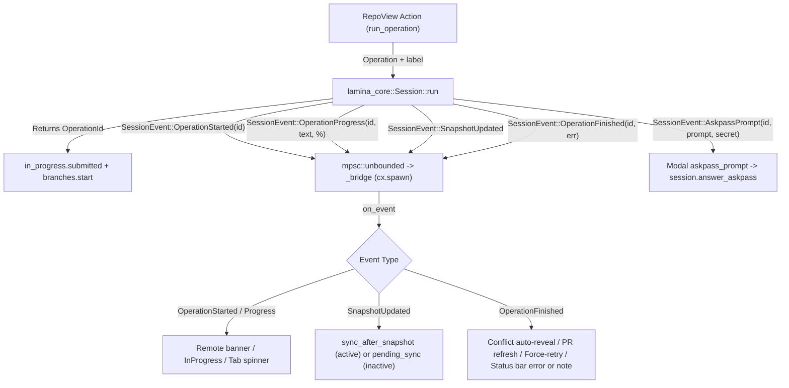
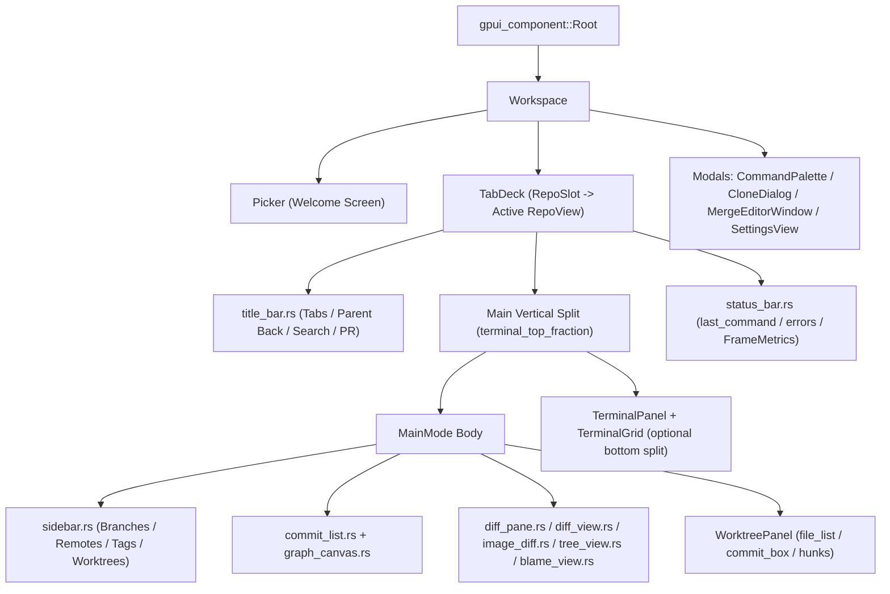

# GPUI UI レイヤ設計 (`crates/lamina-app`)

本書は Lamina のデスクトップ UI クレート `crates/lamina-app` の全体設計を解説する。起動シーケンスからウィンドウ・タブ管理、`RepoView` の状態と非同期データフロー、各種専用ビューの描画戦略、共通 UI キット、テーマ・キーマップ・設定・国際化・外部連携、およびヘッドレス検証手法までを扱う。リポジトリ全体の構造とコア層については [設計ドキュメント一覧](README.md)・[アーキテクチャ概要](architecture.md)・[コア設計](core.md)、埋め込みターミナルについては [埋め込みターミナル設計](terminal.md) を参照。

---

## 1. 起動フロー・ウィンドウ構成・タブ管理

### 1.1 エントリポイントと初期化順序 (`crates/lamina-app/src/main.rs`)

`main()` は最初に `lamina_core::askpass::helper_main(...)` を呼び出す。git が資格情報ヘルパとして自身を再起動した場合、UI や GPUI アプリケーションを一切立ち上げず標準入力/プロンプト経由の応答だけを行って即座に終了する (askpass 短絡起動)。

通常起動時は `env_logger::init()` のあと `debug_launch::parse_args()` でコマンドライン引数を解析 (`--help` 時はヘルプを表示して終了) し、`gpui_platform::application().with_assets(assets::AppAssets)` を構築する。macOS では `app.on_reopen` で全ウィンドウ閉鎖後の Dock クリックからの再オープンを登録し、`app.run` コールバック内で以下の順に初期化する。

1. `gpui_component::init(cx)`: `gpui-component` 基盤と既定テーマの初期化。
2. `settings::init(cx)` と `i18n::apply(cx)`: `settings.json` 読込・終了時フラッシュ登録とロケール適用。
3. `tools::init(cx)` / `keymap::init(cx)` / `commands::init(cx)` / `workspace::init(cx)`: 外部ツール検出、`ACTIONS` レジストリとユーザーキーマップ、カスタムコマンド、`SessionRegistry` と `on_app_quit` フックの初期化。
4. 各モジュールのアクション・デフォルトキーバインド登録: `actions::bind` → `settings_view::bind` → `git_config_view::bind` → `worktree_panel::bind` → `branches::bind` → `branch_switcher::bind` → `conflicts::bind` → `remote::bind` → `search::bind` → `picker::bind` → `palette::bind` → (`#[cfg(feature = "terminal")]`) `terminal_panel::bind`。この登録順 (`keymap::GROUP_ORDER`) が同一キー衝突時の優先度を決定する。
5. ユーザー上書きとウォッチャー起動: `commands::bind_keys(cx)` および `keymap::apply_user(cx)` によりデフォルトの上にユーザー定義を上書きし、`keymap::watch(cx)` と `commands::watch(cx)` で `keymap.json` / `commands.json` の外部編集ポーリングを開始する。
6. ウィンドウ生成: `open_start(start, debug, cx)` を呼び出し、コマンドライン指定または `workspace::restored_windows(cx)` の保存済みセッション、あるいはウェルカム画面 (`Picker`)・`--gallery` ウィンドウを開く。起動直後にキーマップやカスタムコマンドのパースエラーがあれば `keymap::report_to_window(cx)` / `commands::report_to_window(cx)` でウィンドウへ通知する。

### 1.2 ウィンドウ・ワークスペース・タブ (`workspace.rs`, `tabs.rs`)

GPUI の `gpui_component::Root` はウィンドウ作成時に単一のルート子要素を持つ前提のため、`Workspace` (`crates/lamina-app/src/workspace.rs`) が `Root` 直下に常駐し、内部の `Content` 列挙体 (`Welcome(Entity<Picker>)` または `Tabs(TabDeck<RepoSlot>)`) を差し替える構造を採る。

- **タブ管理モデル (`crates/lamina-app/src/tabs.rs`)**:
  - `TabDeck<T>` は GPUI 非依存の純粋なコレクションとして切り出されており、タブ追加 (`open`)・選択 (`select`)・1..=9 ジャンプ (`jump`)・循環 (`cycle`)・末尾閉鎖判定 (`CloseOutcome::ClosedLast` 等) を単体テストできる。
  - `SessionRegistry` が全ウィンドウの開閉と `session.json` 永続化 (`SavedSession`, `SavedWindow`) を追跡する。アプリ終了時 (`quitting = true`) に閉じられる個別ウィンドウが `session.json` を上書き消去しないよう保護する仕組みを持つ。
- **タブごとの親子ナビゲーション (`NavigationStack`, `ParentRepo`)**:
  - 各タブを表す `RepoSlot` は、作業ディレクトリ (または bare リポジトリの git dir) の正規化パスに加えて `NavigationStack` を持つ。
  - サブモジュールやリンク済みワークツリーを「現在のタブ内で開く」(`OpenDisposition::PushParent`) と元のリポジトリが `parents` スタックへ積まれ、タイトルバーの戻る操作で元のリポジトリへ戻れる。
- **非アクティブタブの抑制とバックグラウンド破棄**:
  - ウィンドウ上に描画されるのは `TabDeck::active()` の `RepoView` のみである。裏に回ったタブは `set_active(false)` によって自動フェッチタイマーと `cx.notify()` 再描画を止め、バックグラウンドのファイルウォッチャ (`Session`) のみを維持して切り替えを即時にする。タブ側で受信したスナップショット更新は `pending_sync` / `pending_reveal_conflicts` に記録され、再アクティブ化時に反映される。
  - タブ閉じやリポジトリ切り替え時は `RepoView::detach_session` でイベントブリッジと進行中クエリチケットをすべてキャンセルしたうえで、`Session` を `drop_session_in_background` (`std::thread::spawn` 名 `lamina-session-drop`) へ渡して破棄する。`Session::drop` はワーカースレッドを `join()` するため、UI スレッドでのフリーズを防ぐ必須の設計である。

---

## 2. `RepoView` の構造と非同期データフロー (`repo_view.rs`, `repo_view/`)

### 2.1 所有状態とモジュール分割

`RepoView` (`crates/lamina-app/src/repo_view.rs`) は 1 つのリポジトリ (または `--fake` の合成データ) に対応するメインビューであり、責務ごとに `crates/lamina-app/src/repo_view/` サブモジュールへ分割されている。

| サブモジュール / 要素 | 責務 |
|---|---|
| `repo_view.rs` | `RepoView` 本体・`Launch` 初期化・イベント集約・`run_operation`・選択同期・`DebugLaunchRunner` |
| `repo_view/chrome.rs` | 全体レイアウト組み立て、メニューバー/ダイアログ連携、エラー状態表示 |
| `repo_view/title_bar.rs` | カスタムタイトルバー (リポジトリ名・`ParentRepo` 戻りボタン・タブストリップ連携・PR/検索トグル) |
| `repo_view/status_bar.rs` | ステータスバー (`last_command` の実行時間付き表示、`status_error` / `status_note`、フレームメトリクス等) |
| `repo_view/sidebar.rs` | ブランチ・リモート・タグ・スタッシュ・サブモジュール・ワークツリー一覧、コンテキストメニュー |
| `repo_view/commit_list.rs` | 仮想化コミット一覧とグラフ列の統合、`CommitRow` 描画、選択操作 |
| `repo_view/commit_graph.rs` | `commit-graph` ファイル生成提案 (`commit_graph_offer`) と実行制御 |
| `repo_view/diff_pane.rs` | コミット詳細ヘッダ、変更ファイル一覧 (`files`)、差分ペイン、複数選択差分 (`selection_diff`)、ファイル比較 (`compare`) |
| `repo_view/in_progress.rs` | `InProgress` バナー (merge / rebase / cherry-pick / revert 中断状態の検知・続行/中止・コンフリクト自動遷移) |
| `repo_view/split.rs` | `SplitExtents` によるペイン分割比率のウィンドウ幅・高さ比例スケーリングと永続値同期 |
| `repo_view/tree_view.rs` | コミット時点のツリーブラウザ (`TreeBrowser`) |
| `repo_view/blame_view.rs` | 行単位アノテーション・ヒートマップ表示 (`BlameView`) |

`RepoView` の主要モードは `MainMode` (`History` / `Worktree` / `Compare`) で管理され、選択コミット (`selected`, `selection: CommitSelection`)、ファイル選択 (`selected_file`)、各種非同期スロット (`DiffSlot`, `ExtraLists`, `CommitStatSlot`, `SignatureTracker`, `SearchState`, `ReflogState`, `Remote`, `PullRequests`, `WorktreePanel`)、そして `terminal` パネル (`#[cfg(feature = "terminal")]`) を保持する。

### 2.2 スナップショット受信と操作ライフサイクル

`lamina_core::session::Session` のバックグラウンドスレッドから届く `SessionEvent` は、`mpsc::unbounded` チャネル経由で `RepoView::new_in_workspace_active` が起動した `cx.spawn` タスク (`_bridge`) に渡され、フォアグラウンドエグゼキュータ上で `RepoView::on_event` を実行する。

- **二重実行防止とビジー状態**: `RepoView::is_busy()` は `branches.is_running()` または `session.snapshot().busy.is_some()` で判定され、`run_operation` はビジー時や `--fake` モード時に操作を拒否する。開始時には `OperationId` が発行され、`in_progress.submitted(id, kind)` と `branches.start(id, label, retry)` に紐づけられる。
- **完了処理 (`OperationFinished`)**: 操作完了直前のスナップショット更新でコンフリクト数が反映されるため、`in_progress.finished(id, conflicts)` が競合発生を検知するとアクティブ時は即 `reveal_conflicts` で作業ツリーコンフリクト解決へ遷移させる (非アクティブ時は `pending_reveal_conflicts = true`)。また push 完了時は `PullRequests::take_pending_push()` によりスロットリングなしで PR 一覧を再取得し、unmerged ブランチ削除拒否など復旧可能なエラーでは `branches::offer_force` ダイアログを提示する。
- **チケット/エポックによる陳腐化応答の破棄**: Diff 取得 (`DiffSlot` の `QueryTicket`)、コミットファイル一覧 (`files_epoch` / `worktree_lfs_epoch`)、サブモジュール/ワークツリー一覧 (`ExtraLists`)、検索・blame・reflog はすべてチケットまたは単調増加エポック番号で管理されており、選択変更や `detach_session` 後に遅れて届いた古いイベントは `accept(ticket, ...)` で黙って破棄される。

### 2.3 弱参照ルールとメモリリーク防止

`RepoView` 自身は `entity: WeakEntity<RepoView>` を保持し、レンダー中の要素コールバックが `Entity<RepoView>` を必要とする場合のみ `RepoView::entity()` で `upgrade()` する (`crates/lamina-app/src/repo_view.rs`)。非同期タスク (`cx.spawn` 等) やダイアログコールバックが `Entity<RepoView>` (強参照) を直接キャプチャすると、ウィンドウを閉じた後も `RepoView` が解放されず `Session` ワーカーも残り続けるため、すべて `WeakEntity` 経由に統一されている。この不変条件はテスト `closing_a_window_releases_its_repo_view` で自動検証されている。

---

## 3. コンポーネント構成・レンダリング戦略・各種専用ビュー

### 3.1 コミットグラフ描画 (`crates/lamina-app/src/graph_canvas.rs`)

コミット履歴の各行左側に描画されるグラフは、GPUI の `canvas` 要素 (`GraphCell`) として実装されている。

- **レーン制限と色割り当て**: 同時描画レーン数の上限を `MAX_LANES = 12` とし、レーン番号を `Design::lane` パレット色へ対応付ける。
- **バッチ描画**: 実線セグメント・マージドット・ノード本体は `paint_quad` で矩形/角丸として描画し、分岐・合流の曲線 (`Edge`) は `PathBuilder` をレーン色ごとにグルーピングしてベジェ曲線を構築・`paint_path` することでパス発行回数を削減する。
- **グラデーションと境界表現**: フェード開始/終了エッジはアルファグラデーション付きの細切れポリラインまたはマスクで表現し、shallow clone の境界コミットには専用マーカーを描画する。

### 3.2 仮想化リストと差分表示 (`commit_list.rs`, `diff_view.rs`, `scrollbar.rs`)

- **履歴リスト (`crates/lamina-app/src/repo_view/commit_list.rs`)**: 全行が固定高であるため GPUI の `uniform_list` を用い、数万件のコミットがあっても可視範囲外の行は要素生成されない。
- **差分ビュー (`crates/lamina-app/src/diff_view.rs`)**:
  - **2 系統の仮想化エンジン**: 行折り返しが無効 (`wrap = false`) かつ等高行のときは高速な `uniform_list` を使う。行折り返しが有効 (`wrap = true`) なときは行ごとに高さが不定となるため、分割表示の左右が同じ行で高さを揃える `WrappedLists` と可変高仮想リスト `gpui::list` を採用し、`ListState` をキャッシュする。
  - **再計算抑制 (`DiffStyle::fingerprint`)**: フォント・行高・タブ幅・表示モード (`Unified` / `Split`)・折り返し設定・テーマ等からフィンガープリントを計算し、設定が変わらない限りキャッシュ済みリスト計測を破棄しない。
  - **展開可能コンテキスト (`DiffContext`)**: hunk 間の隠れたコンテキスト行を「上下 20 行展開 / 全て展開」できるギャップ行 (`GapHandler`) を差し込み、`DiffRow` 列を再構築する。シンタックスハイライトおよび行内単語差分ハイライトもフラット化時に解決されたスパンとして描画される。
- **統一スクロールバー (`crates/lamina-app/src/scrollbar.rs`)**: `WithScrollbar` ラッパが `gpui-component` の `Scrollbar` を右端オーバーレイとして重ね、縦スクロールバーを常に同じ操作感とスタイルで提供する。

### 3.3 画像差分・マージエディタ・各種ビュー

- **画像差分 (`crates/lamina-app/src/image_diff.rs`)**: 旧・新リビジョンの画像バイト列を読み込み、**Side-by-Side** / **Swipe** (ドラッグ可能な境界線による比較) / **OnionSkin** (透過オーバーレイ) の 3 モード、`1:1` 等倍またはフィット拡大率、SVG のベクタ描画とソーステキスト diff のトグルを提供する。チェッカーボード背景はピクセル単位で描画する。
- **3-way マージエディタ (`crates/lamina-app/src/merge_editor.rs`, `crates/lamina-app/src/conflicts.rs`)**:
  - 独立ウィンドウとして開くフルスクリーンクラスの解決エディタであり、コンテキスト負荷を抑えるためテキストサイズ上限 **1 MiB**・コンフリクトブロック上限 **200 件** のガードを備える。
  - 中核モデル `MergeModel` (`merge_editor.rs`) は 3-way 解析 (`lamina_core::merge::MergeAnalysis`) の各セグメントをスロット列として保持し、競合箇所ごとの `Choice` (`Ours`, `Theirs`, `OursThenTheirs`, `TheirsThenOurs`, `Base`) やペイン側のチェックボックス (`Side::A` / `Side::B` を表す `Ticked`) を押すと該当スロットだけが即座に差し替わる。さらに結果ペインでの手編集 (`EditorState`, 行ごとの変更種別 `LineMark`) も同一スロット列上の行編集として反映されるため、未解決カウンタと「すべて解決済み」判定が手動編集と整合したまま維持される。
- **作業ツリーパネル (`crates/lamina-app/src/worktree_panel/`)**: `WorktreePanel` (`mod.rs`), `file_list.rs` (Staged / Unstaged / Untracked / Conflicted 分類と検索), `hunks.rs` (hunk / 行単位の部分ステージ・破棄), `commit_box.rs` (コミットメッセージ入力、amend、テンプレート/履歴、署名オプション) から構成され、セクション・ファイル・ハンク単位のキーボード選択モデル (`Selection`) を持つ。
- **Tree / Blame / File History**: `repo_view/tree_view.rs` は任意コミットのファイルツリー閲覧とソースプレビュー・コピー・履歴ジャンプを担い、`repo_view/blame_view.rs` は `BlameProgress` ストリーミングを受信してコミット年代別の行背景ヒートマップ付きでアノテーションを描画し、`file_history.rs` は特定パスに絞った履歴リストと差分ペインを独立して管理する。
- **プロポーショナルスプリット (`repo_view/split.rs`) とフレーム計測 (`metrics.rs`)**: `SplitExtents` はサイドバー幅やコミット一覧比率を設定から復元しつつウィンドウリサイズ時は比率を保ってクランプする。`FrameMetrics` (`F12` または `--smoke` で表示) は直近フレーム時間と P95・ドロップフレーム率を収集し、ステータスバーまたはオーバーレイに表示する。

---

## 4. `crate::ui` キットとデザインシステム

### 4.1 `crate::ui` キットの設計方針 (`crates/lamina-app/src/ui/mod.rs`, `ui/gallery.rs`)

`crate::ui` は `gpui-component` と `Design` トークンを繋ぐ薄いアダプタ層である。機能モジュール (Feature Views) では生の `div()` に直接カラー・パディング・ボーダー等をベタ書きするのではなく、原則として `crate::ui` のコンポーネントおよびヘルパを経由する規約を採っている。

- **提供する主要部品**:
  - テキスト・バッジ・キーキャップ: `ui::text`, `ui::muted`, `ui::mono`, `ui::badge`, `ui::keycap`
  - ボタン・トグル・セグメント・行要素: `ui::button`, `ui::icon_button`, `ui::segmented`, `ui::section_header`, `ui::list_row`
  - モーダル・ダイアログ・スプリット: `ui::confirm`, `ui::askpass_prompt`, `ui::modal`, `ui::split` (`clamp_fraction` 等)
  - 特殊要素: `ui::terminal_grid` (埋め込みターミナル描画)
- **ビジュアル検証 (`ui/gallery.rs`)**: `--gallery` フラグで起動すると、ボタン・バッジ・フォーム・ダイアログ・トーンスケール等を一覧できる UI ギャラリーウィンドウが立ち上がり、実リポジトリを開かずにコンポーネントの見た目とライト/ダーク両テーマの崩れを確認できる。

### 4.2 テーマ・デザイントークン・フォント (`style.rs`, `component_theme.rs`, `assets.rs`)

- **デザイントークン (`crates/lamina-app/src/style.rs`)**: `Design` 構造体がサーフェス階層 (`surface`, `surface_raised`, `sidebar`, `hover`, `selected`)、テキスト階層、セマンティック色 (追加・削除・変更・警告・エラー)、グラフの 12 レーン色、余白・角丸・フォントサイズを集約する。ライト/ダーク両方における前景色と背景色のコントラスト比を検証する単体テストを持つ。
- **`gpui-component` との同期 (`crates/lamina-app/src/component_theme.rs`)**: `component_theme::sync` が Lamina 独自の `Design` トークンから `gpui_component::Theme` の各種色スロットへ値を書き戻すことで、`Input`・`Dropdown`・`Dialog`・`SettingsPages` などのライブラリ部品も Lamina と完全に同じトーンで描画される。
- **アセットと CJK フォールバック (`crates/lamina-app/src/assets.rs`)**: 埋め込み SVG アイコンを `AssetSource` 経由で提供するほか、`font_fallbacks()` により各 OS (macOS / Windows / Linux) 向けのプロポーショナルおよび等幅 CJK フォールバックフォント列 (`Hiragino Sans` / `Yu Gothic` / `Noto Sans CJK JP` 等) を組み立て、`TextSystem` に渡している。

---

## 5. アクション・キーマップ・コマンドパレット・外部ツール

### 5.1 アクションとキーマップレジストリ (`actions.rs`, `keymap.rs`)

- **一元レジストリ (`ACTIONS`)**: `crates/lamina-app/src/actions.rs` でアクション型を定義し、`crates/lamina-app/src/keymap.rs` の `ACTIONS: &[ActionSpec]` テーブルが各アクションの ID・`Group` (`Actions`, `Settings`, `GitConfig`, `Worktree`, `Branches`, `BranchSwitcher`, `Conflicts`, `Remote`, `Search`, `Picker`, `Palette` の 11 グループ)・翻訳キー・既定キー割り当て (`secondary-` によるプラットフォーム修飾子抽象化、`macos_only`、グループ末尾登録用の `deferred`)・コマンドパレット配置 (`PaletteSlot`) を一元管理する。
- **ユーザー上書き (`keymap.json`)**: 設定ディレクトリ内の `keymap.json` でアクション ID ごとにキー文字列配列を指定でき、`null` や空配列 (`Unbind`) で既定ショートカットを無効化できる。`keymap::watch` がファイル変更をポーリング監視し、再起動なしで既定バインディングの再構築とユーザー上書き (`apply_user`) を実行する。また設定画面 (`settings_view`) では実際のキー入力をリアルタイムにキャプチャして割り当てを変更できる。

### 5.2 コマンドパレット (`palette.rs`) とカスタムコマンド (`commands.rs`)

- **コマンドパレット (`crates/lamina-app/src/palette.rs`)**: `Ctrl+Shift+P` (`Cmd+Shift+P`) または `F1` で開くモーダル。`ACTIONS` テーブルおよびロード済みカスタムコマンドから動的に候補一覧を生成し、現在のコンテキスト (ウェルカム画面ではリポジトリ操作を除外) と現在の `keymap.json` 反映済みショートカット表示を連動させる。セッション内の直近実行コマンド最大 5 件 (`MAX_RECENT = 5`) を先頭に並べる。
- **カスタムコマンド (`crates/lamina-app/src/commands.rs`)**: 設定ディレクトリの `commands.json` にユーザーが任意コマンドを定義できる (`commands::watch` でホットリロード)。実行時はシェル文字列を介さず `argv` を直接組み立てて起動するためコマンドインジェクションを防ぎつつ、`${repo}`・`${branch}`・`${commit}`・`${file}`・`${remote}` のプレースホルダ変数展開に対応する。

### 5.3 外部ツール連携 (`external_tools.rs`, `tools.rs`)

`crates/lamina-app/src/external_tools.rs` および `crates/lamina-app/src/tools.rs` はエディタ・マージツール・外部シェル・`ghq`・`gh` CLI との連携を担う。`split_command` による引用符を考慮したコマンドライン分割と、プラットフォーム別実行・`PATH` 探索・`ghq` ルート検出を提供する。

---

## 6. 設定永続化と設定画面 (`settings.rs`, `settings_view/`)

- **保存形式と場所 (`crates/lamina-app/src/settings.rs`)**: `Settings` グローバルが JSON 形式 (`settings.json`) として保存される。保存先は環境変数 `LAMINA_CONFIG_DIR` が優先され、未設定時は各 OS の標準設定ディレクトリ (`~/Library/Application Support/Lamina`, `%APPDATA%\Lamina`, `$XDG_CONFIG_HOME/lamina`) となる。
- **デバウンス保存とライブ反映**: UI 変更は `settings::update` によって即座に `Settings` グローバルへ反映され、`cx.observe_global::<Settings>` を購読している全ウィンドウへ次フレームから適用される。ディスク書込は `SaveCoalescer` が **300 ms** (`SAVE_DEBOUNCE`) のデバウンスを行ってまとめ、`on_app_quit` で未書込分を `flush` する。
- **設定セクション (`Section::ALL`, 8 セクション)**: `Appearance`, `Diff`, `History`, `Behaviour`, `Tools`, `Privacy`, `Keyboard`, `Commands` の 8 ページを `crates/lamina-app/src/settings_view/pages.rs` と `change.rs` が描画・検証する。設定画面 (`crates/lamina-app/src/settings_view.rs`) は独立ウィンドウ (`SettingsView`) として開き、1 インスタンスのみアクティブに保つ。

---

## 7. 国際化 (`i18n.rs`, `crates/lamina-app/locales/*.yml`)

- **仕組み**: `rust-i18n` クレートをクレートルート (`crates/lamina-app/src/main.rs`) で初期化し、`crates/lamina-app/locales/en.yml` と `ja.yml` から翻訳マクロ `t!` を提供する (`crates/lamina-app/src/i18n.rs`)。起動時 (`i18n::apply`) および設定変更時 (`Language::System` / `En` / `Ja`) にロケールを切り替える。
- **OS ごとの自動言語判定 (`detect_os_locale`)**:
  - **macOS**: CoreFoundation の `AppleLanguages` 配列を読み取る。
  - **Windows**: `GetUserDefaultUILanguage` でプライマリ言語 ID を判定する。
  - **Linux / その他 Unix**: 環境変数 `LC_ALL` → `LC_MESSAGES` → `LANG` の順で判定する。
- **文字列追加ルールと整合性テスト**: `i18n.rs` 内の単体テストが全ロケール YAML ファイルを走査し、(1) 英語と日本語で翻訳キー集合が完全一致すること、(2) `%{...}` プレースホルダ集合が一致すること、(3) `ACTIONS` レジストリの全アクションタイトル翻訳キーが存在すること、をビルドテスト時に保証している。

---

## 8. GitHub 連携・自動フェッチ・クローン・最近の履歴

- **GitHub PR 連携 (`github.rs`, `pull_requests.rs`)**: `gh` CLI を介してリポジトリに紐づくプルリクエスト一覧・CI チェック状態を取得する。`pull_requests.rs` は自動リフレッシュに **60 秒** のスロットリングを設ける一方、push 完了後 (`RefreshCause::AfterPush`) は即座に再取得する。フォークからの PR についても `head_owner` を照合してブランチへ正確に紐付け、`CheckoutDialog` からローカルチェックアウトを行える。
- **自動フェッチ (`autofetch.rs`)**: `RepoView` がアクティブな間、5 秒ごとの `TICK` ループで `settings.behaviour.auto_fetch_minutes` 経過と `is_busy()` をチェックし、条件を満たせばバックグラウンドでフェッチを起動する。
- **クローンダイアログ (`clone_dialog.rs`)**: 進捗チャネルを 50 ms 間隔でポーリングしながらプログレス表示を行い、認証要求が来た場合は askpass ブリッジ経由でモーダルに入力を求める。キャンセル時は途中作成されたディレクトリを清掃する。`ghq` が検出されている場合は `ghq` ルート配下を保存先候補として自動提案する。
- **最近の履歴 (`recent.rs`)**: `recent.json` に最大 20 件 (`MAX_RECENT = 20`) の履歴を保持する。パス登録時に正規化 (`canonicalize`) を行い、Windows 環境の UNC プレフィックス (`\\?\`) を除去して重複登録を防ぐ。

---

## 9. デバッグ起動・Fake/Gallery モード・ヘッドレス UI テスト

### 9.1 デバッグ起動フラグ (`crates/lamina-app/src/debug_launch.rs`, `fake.rs`)

UI の特定状態をコマンドラインから即座に再現し、目視確認やベンチマーク・スクリーンショット採取を容易にするため豊富な CLI フラグを備えている。

| フラグ | 用途 |
|---|---|
| `--fake` | `crates/lamina-app/src/fake.rs` が生成する合成コミットグラフ・差分データで起動 (実リポジトリ不要) |
| `--gallery` | `ui/gallery.rs` のコンポーネントギャラリーウィンドウを起動 |
| `--select <rev[,rev...]>` | 指定リビジョン (単一または複数) のロード完了を待って自動選択 |
| `--tree <rev>` / `--tree-file <path>` | 指定コミットのツリーブラウザを開き、特定ファイルを選択 |
| `--blame <rev>:<path>` | 指定コミット・パスの Blame ビューを自動オープン |
| `--worktree` | 起動時に作業ツリーモードへ切り替え |
| `--dialog <name>` | `create-branch`, `stash`, `add-worktree`, `create-tag`, `open-repository`, `settings`, `palette` を開く |
| `--window-size <W>x<H>` | ウィンドウ初期サイズを指定 (環境変数 `LAMINA_SMOKE` で描画フレーム計測オーバーレイも有効化) |

`RepoView` 内の `DebugLaunchRunner` (`crates/lamina-app/src/repo_view.rs`) はスナップショット更新ごとにリビジョン解決を進め、履歴ウォーク上に該当コミットが到達した時点で選択・ビューオープンを実行する。

### 9.2 ヘッドレス UI テスト手法

`crates/lamina-app` の統合・UI テストは `#[gpui::test]` と GPUI の `TestAppContext` / `VisualTestContext` を用いて OS ウィンドウサーバーなしで実行する設計になっている。

- **`Launch::open_quiet`**: 通常起動と同じ `Session`・`RepoView` をバックグラウンドで生成しつつテスト側で同期・検証し、完了時にはテストウィンドウ閉鎖によって `RepoView` が確実にドロップされること (`closing_a_window_releases_its_repo_view`) まで検証する。
- **純粋状態モジュール分離**: タブ操作 (`tabs.rs`)、マージ競合スロット (`merge_editor.rs`)、差分フラット化 (`diff_view.rs`)、キーマップ解析 (`keymap.rs`)、ターミナルグリッド座標計算 (`ui/terminal_grid.rs`) といったロジックは GPUI ウィンドウ非依存の関数・構造体として書かれており、軽量な `#[test]` で境界ケースを網羅している。
