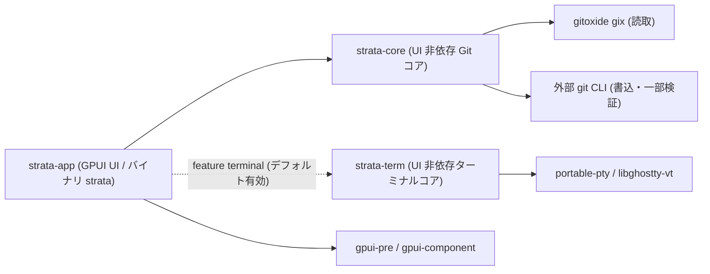
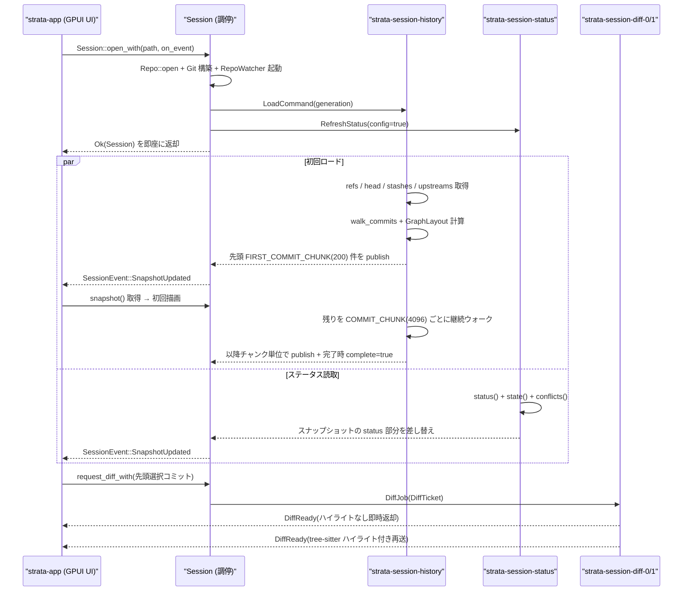
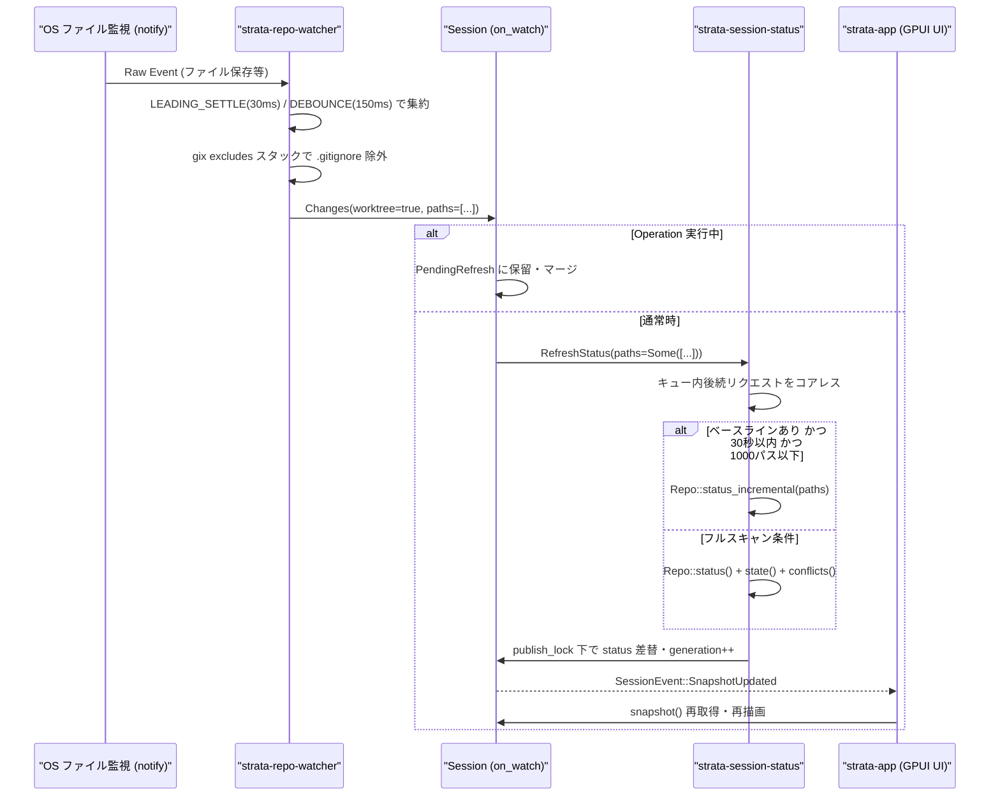

# Strata 全体アーキテクチャ

## 1. 目標と非目標

### 目標

- **大規模リポジトリでの高速性**: 数十万コミット規模の履歴（ベンチマーク目標として 200,000 コミット）を想定し、履歴ウォーク・グラフレイアウトのチャンク分割配信、パス変更 Bloom フィルタや commit-graph の活用、インクリメンタルなステータス更新、仮想化リスト（`uniform_list`）により初回表示とスクロールを軽量に保つ（`crates/strata-core/src/session/mod.rs`, `crates/strata-core/src/graph/mod.rs`, `crates/strata-app/README.md`）。
- **ネイティブかつ軽量**: Rust 製ネイティブアプリケーションとして GPU アクセラレーション描画（GPUI）を用い、コアロジック（`strata-core` / `strata-term`）を UI ツールキットや非同期ランタイムから独立させることで、省メモリかつ低い要素構築コストを実現する（`docs/building.md`, `crates/strata-app/README.md`）。
- **正確な Git 挙動の維持**: ユーザー設定、`.gitattributes`、フックスクリプト、認証ヘルパー、GPG/SSH 署名、Git LFS などの挙動を独自再実装で歪めず、ターミナル上の `git` と同一の結果を保証する（`crates/strata-core/src/lib.rs`, `crates/strata-core/src/git_cli/mod.rs`）。
- **プラットフォーム優先度**: macOS と Windows を第一ターゲットとし、Linux はベストエフォートでサポートする。CI（`.github/workflows/ci.yml`）では `ubuntu-latest` / `macos-latest` / `windows-latest` の 3 環境すべてで `clippy` とワークスペース全体のテストを実行している。Windows は `fxc.exe` による HLSL シェーダコンパイルのためネイティブビルドを前提とし、Linux 向けには `flake.nix` による Nix 開発シェルや Wayland / X11 バックエンド対応を備える（`docs/building.md`, `crates/strata-app/Cargo.toml`）。

### 非目標

- **Git 書込・署名・認証処理の Rust 独自再実装**: コミット作成、マージ、リベース、リモート通信、クレデンシャル管理、署名検証を独自に再実装しない。これらは外部 `git` バイナリ（`MIN_GIT_VERSION = (2, 30, 0)`）へ委譲する（`crates/strata-core/src/git_cli/mod.rs`）。
- **`git` 本体の同梱**: `git` 実行ファイルは実行時環境（`PATH` またはユーザー設定のパス）に依存し、アプリケーション側にはバンドルしない（`docs/building.md`, `crates/strata-core/src/session/mod.rs`）。
- **UI ライブラリへのコア層の結合**: `strata-core` および `strata-term` に GPUI 固有型や UI 状態を持たせない。

---

## 2. クレート構成と依存方向

ワークスペース（`Cargo.toml`）は `strata-core`、`strata-term`、`strata-app` の 3 クレートで構成される（Rust Edition 2024）。



- **`crates/strata-core`**: Git 読取、コマンド実行、セッション調停、グラフ配置、差分計算、部分パッチ生成、3-way マージ解析、tree-sitter ハイライト、エンコーディング判定、ファイル監視などを担う UI 非依存ライブラリ（`crates/strata-core/src/lib.rs`）。外部の非同期ランタイム（tokio 等）にも依存せず、`std::thread` と `std::sync::mpsc` のみで並行処理を構成する。
- **`crates/strata-term`**: `libghostty-vt` と `portable-pty` 上に構築された UI 非依存の組み込みターミナルコア（`crates/strata-term/src/lib.rs`）。ライブラリ本体は GPUI に依存しない（`examples/demo.rs` と `dev-dependencies` のみ確認用に `gpui` を参照）。
- **`crates/strata-app`**: `strata` バイナリを提供する GPUI アプリケーション（`crates/strata-app/Cargo.toml`, `crates/strata-app/src/main.rs`）。`gpui-pre` (`=0.3.12`)、`gpui-pre-platform`、`gpui-component` (`0.9.1`) を利用する。`strata-term` への依存はデフォルト有効の `terminal` フィーチャで切り替えられる。

依存方向は常に **`strata-app` → `strata-core` / `strata-term`** の一方向であり、`strata-core` と `strata-term` の相互依存も存在しない。

---

## 3. 中核ルール: 読取は `gix`、書込は `git` CLI

Strata 全体を通底する設計原則は、**「リポジトリの読取は `gitoxide`（`gix`）、リポジトリの状態を変更する書込は `git` CLI」** という責務分離である（`crates/strata-core/src/lib.rs`, `crates/strata-core/src/git_cli/mod.rs`）。

### なぜこの分離を採るのか

1. **参照系のゼロプロセス起動コストとキャンセル制御**: 履歴ウォーク、ステータススキャン、ツリー差分、ファイル内容取得、blame、コンテンツ検索などはプロセス起動オーバーヘッドなしにインプロセスで実行でき、`AtomicBool` や世代番号による協調的キャンセル、Bloom フィルタやインクリメンタル差分の細粒度最適化が可能になる。
2. **更新系の完全な互換性（正しさ・フック・設定・認証）**: ステージング、コミット、リベース、マージ、フェッチ・プッシュ、クローンなどを `git` CLI 経由で実行することで、以下がターミナルと完全に同じ挙動になる。
   - ユーザー設定の `pre-commit` / `commit-msg` 等のフックスクリプト
   - `user.signingkey`、`gpg.format`、`commit.gpgsign` による GPG / SSH / X.509 署名
   - `.git/config`・グローバル設定・`credential.helper`（OS キーチェーンや各種認証ヘルパー）
   - Git LFS フィルターや sparse-checkout などの設定連動

### 例外（読取系でも `git` CLI を使う箇所）

一部の読取系機能は、`gix` の機能・性能・設定継承上の理由から意図的に `git` CLI を併用している。

- **Blame フォールバック**（`crates/strata-core/src/repo/blame.rs`, `crates/strata-core/src/git_cli/blame.rs`）: `gix-blame` は現状、途中のキャンセル手段を持たず、shallow クローンの境界を正しく止められず、深い履歴の走査が遅いため、**shallow リポジトリ**・**対象 blob が `GIX_MAX_BLOB_BYTES` (64 KiB) 超**・**第一親の深さが `GIX_MAX_DEPTH` (256) 超** のいずれかに該当する場合は `git blame --incremental` へフォールバックする。
- **署名検証**（`crates/strata-core/src/repo/signature.rs`, `crates/strata-core/src/git_cli/signature.rs`）: 署名有無の一次判定（`gpgsig` / `gpgsig-sha256` ヘッダ確認）は `gix` で高速に行い、実際の暗号検証は `git log --no-walk=unsorted --stdin -z` に委ねる。ユーザーの GPG キーリングや `gpg.ssh.allowedSignersFile`、X.509 信頼ストアをそのまま適用するためである。
- **Stash / Index / LFS / 状態補助**（`crates/strata-core/src/git_cli/ops.rs`, `merge.rs`, `lfs.rs`）: 一部の操作（`stash_list` やコンフリクト時の `ls-files --stage -z`、`lfs version` / `lfs locks --json` 等）は `git` CLI を利用する。

### `git` CLI 採用に伴う帰結と周辺機構

書込をすべて `git` CLI に委譲した帰結として、GUI アプリケーション側で以下の 3 つの仕組みが必要になる。

1. **Askpass ブリッジ（`crates/strata-core/src/askpass.rs`）**:
   GUI 環境では標準入力端末が存在しないため、`Git` ハンドルは常に `GIT_TERMINAL_PROMPT=0` を設定して対話入力待ちのハングを防ぐ。一方、設定済みの `credential.helper` で解決できないネットワーク認証（HTTPS のユーザー名・パスワード、SSH パスフレーズ等）をユーザーへ問い合わせるため、ネットワーク系コマンド実行時のみ一時的な `AskpassHost`（Unix ドメインソケットまたは Windows のループバック TCP + ワンタイムトークン）を起動し、`GIT_ASKPASS` / `SSH_ASKPASS` に `strata` 自身の実行ファイルを指定する。`crates/strata-app/src/main.rs` の先頭で `strata_core::askpass::helper_main` を最初に判定することで、ディスプレイサーバや設定ファイルを一切初期化せずに認証応答を `stdout` へ返す。
2. **進捗パース（`crates/strata-core/src/git_cli/progress.rs`, `crates/strata-core/src/session/operations.rs`）**:
   `fetch` / `pull` / `push` のストリーミング版は `--progress` を付与して実行し、標準エラー出力を行単位（`\r` / `\n` 区切り）で読み取りパーセンテージを抽出する。UI への過剰な通知を避けるため `Session` 側では `PROGRESS_INTERVAL` (50ms) で間引きつつ、最終行だけは必ず `OperationProgress` として通知する。
3. **コマンドログ（`crates/strata-core/src/git_cli/command_log.rs`）**:
   GUI の背後で実行されたすべての `git` 呼び出し（引数、開始時刻、所要時間、終了コード、最大 `MAX_CAPTURE_BYTES` = 64 KiB までの stdout/stderr）を上限 `MAX_LOG_ENTRIES` = 500 件のリングバッファ `CommandLog` に記録し、`SessionEvent::CommandLogged` 経由で UI のコマンドログパネルへ配信する。これにより CLI ベースの処理が透明化され、エラー時の原因調査が容易になる。

---

## 4. スレッドモデルとデータフロー

### リポジトリを開く仕組みとスナップショット配信

UI（`crates/strata-app/src/repo_view.rs`）は `Launch::open` / `Launch::open_with` から `Session::open_with` を呼び出す。`Session`（`crates/strata-core/src/session/mod.rs`）は `Repo::open` でリポジトリを検証し、セッション開始時点で `git` バイナリパスを固定した `Git` ハンドルを構築した上で、複数の専用ワーカースレッドと `RepoWatcher` を起動し、即座に `session.reload()` を投入して戻る。

UI はスナップショットを **`Session::snapshot()`**（`Shared` 内の `RwLock<Arc<RepoSnapshot>>` の読取ロックで `Arc` を複製）で取得する。`RepoSnapshot` は不変構造体であり、更新のたびに単調増加する `generation` を持つ。`CommitList` は `COMMIT_CHUNK` (4096 件) 単位の `Vec<Arc<CommitChunk>>` で保持される追記型リストであり、部分更新時も既存チャンクを再利用するため UI 側へのクローンコストが極めて小さい。

`Session` が生成するイベント（`SessionEvent`）はバックグラウンドスレッドからコールバック `on_event` へ渡され、`strata-app` 側では `futures::channel::mpsc::unbounded` 経由で GPUI のフォアグラウンドタスクへ転送し、ビュー状態を更新して `cx.notify()` を呼ぶ。



### ファイル監視とインクリメンタル更新

ファイルシステム監視は `crates/strata-core/src/watch.rs` の `RepoWatcher` が担う。`notify::recommended_watcher` のコールバック自体はブロックしないよう無制限チャネルへ転送するだけとし、専用スレッド `strata-repo-watcher` がデバウンス（先頭バースト収束 `LEADING_SETTLE` = 30ms、静穏待ち `WATCH_DEBOUNCE` = 150ms、連続ストリーム時上限 `MAX_LATENCY` = 1s）と `.gitignore` / `info/exclude` / グローバル ignores に基づく除外フィルタリングを実行する。なお、ワークツリー内部に `.git` がある通常リポジトリではワークツリー再帰監視のみで `.git` も網羅し、別ディレクトリのワークツリーやサブモジュールのように `.git` が外部にある場合のみ `git_dir` も別途監視する。

監視イベント `Changes` は `session/mod.rs` の `on_watch` で振り分けられる。

- `refs` または `head` が変化した場合: `shared.reload()`（`history` と `status` 両方の再読取）および署名キャッシュの無効化を行う。
- `worktree` / `index` / `rescan` のみが変化した場合: `strata-session-status` へ `RefreshStatus` を送る。このとき **操作（`Operation`）が実行中** であれば即座に走らせず `PendingRefresh` に畳み込んで保留し、操作完了後にまとめて反映する（`operations.rs`）。
- ステータス更新ワーカー（`crates/strata-core/src/session/refresh.rs`）は、前回のベースラインが存在し、最後のフルスキャンから `SAFETY_FULL_SCAN_INTERVAL` (30秒) 以内であり、かつ変更パス数が `MAX_INCREMENTAL_PATHS` (1000件) 以下で `.git` 内部ファイルや `.gitignore`/`.gitattributes` の変更を含まない場合に限り、変更パスのみを対象とする高速な `Repo::status_incremental` を実行する。条件を外れた場合や `rescan` フラグが立っている場合は通常のフルスキャンへフォールバックする。



### バックグラウンド処理・直列化・キャンセル

`Session` は性質の異なる処理が互いをブロックしないよう、ワーカーを役割ごとに分離している（`crates/strata-core/src/session/mod.rs`）。

- **`strata-session-history`**: 履歴ウォークとグラフ計算。新しい `reload()` で `generation` が進むと、進行中のウォークは `cancelled` クロージャ（`!shared.is_current(generation)`）により途中中断される。
- **`strata-session-status`**: ワークツリー状態とコンフリクト更新。キューに溜まった複数リクエストを 1 回へ畳み込む。
- **`strata-session-operations`**: `Operation` 列挙型で表されるすべての書込処理。**常に 1 つずつ直列実行** し、実行中は `snapshot.busy = Some(OperationId)` を公開する。完了後は `status`（必要なら `load`）へ更新を要求し、`ack` チャネルでスナップショット反映完了を待機（タイムアウト `REFRESH_TIMEOUT` = 60秒）してから `busy` を解除し `OperationFinished` を送る。これにより、UI が古い状態のまま操作完了を認識して二重操作する競合を防ぐ。
- **`strata-session-diff-0` / `strata-session-diff-1`**（`DIFF_WORKERS = 2`）: 差分計算と構文ハイライト。2 スレッド並列とすることで、ピン留めされた大きな差分が選択追従の差分計算を詰まらせることを防ぐ。キャンセルは `cancel_diff(DiffTicket)` で行う。
- **`strata-session-queries`**: コミット検索、パス履歴（ストリーミング含む）、コミット行数統計、2コミット比較（`Compare` / `CompareFrom`）、サブモジュール・ワークツリー一覧、進行中詳細、reflog 取得を担当。
- **`strata-session-blame`** / **`strata-session-content-search`** / **`strata-session-signatures`**: 非常に重い履歴走査や外部 CLI 呼び出しを行うため、`strata-session-queries` から独立した専用スレッドを持つ。`QueryTicket` 単位のキャンセルが発行されると、`QueryState` のキャンセル集合に登録され、インプロセスのループ停止に加えて `git_cli::Git::run_output_cancellable` 経由で起動中の `git` 子プロセスも `kill()` する。`signatures` は単一ワーカーに制限することで高速スクロール時の `git` プロセス乱立を防ぎ、エポック番号付き `SignatureCache` を保持する。

---

## 5. エラー処理モデル

`crates/strata-core/src/error.rs` で定義される `Error` は、意図的に粗粒度な 5 バリアントのみを持つ。

```rust
pub enum Error {
    Io(#[from] std::io::Error),
    Gix(#[source] Box<dyn std::error::Error + Send + Sync + 'static>),
    GitCommand {
        args: String,
        code: Option<i32>,
        stderr: String,
    },
    NotARepository(PathBuf),
    Other(String),
}
```

### 機能別バリアントを持たない理由

- **読取系（`Error::Gix` / `Error::Other`）の非分岐性**: `gix` の各サブクレートは多数の細かなエラー型を返すが、UI や `Session` 側が読取エラーの種類に応じてプログラム的にリカバリ分岐を行うケースはほとんどなく、ほとんどは失敗メッセージとしてユーザーへ提示するかログに記録するだけである。機能別バリアントを列挙するとボイラープレートが増大するため、`Error::gix(...)` で型消去ボックス化しつつ原因メッセージ・ソースチェーンを保持する設計を採っている。
- **`GitCommand` による構造化保持**: 書込側の `git` CLI 失敗については、呼び出し元が終了コードや `stderr` の内容を検査して正常系分岐（例: `git_cli/ops.rs` の `finish_pull` におけるコンフリクト停止の許容、`git_cli/history.rs` のチェリーピック時の空コミット/コンフリクト判定、`apply_commit` 等）や詳細なエラー表示を行えるよう、`args`・`code`・`stderr` の 3 フィールドを保持している。

---

## 6. テスト戦略

1. **隔離された一時リポジトリによる実 `git` 結合テスト（`crates/strata-core/src/test_support.rs`）**:
   モックだけで Git の挙動を偽装せず、`TestRepo` ヘルパーが `tempfile::TempDir` 内に実リポジトリを初期化する。マシン固有の環境差を完全に排除するため、以下を徹底している。
   - `GIT_CONFIG_GLOBAL` を一時ディレクトリ内の専用 `gitconfig`（`gpgsign = false`, `core.autocrlf = false`, `init.defaultBranch = main` 等）へ差し替え
   - `GIT_CONFIG_NOSYSTEM=1` でシステム設定を遮断
   - `GIT_AUTHOR_*` / `GIT_COMMITTER_*` および固定時刻 `TIME = "1700000000 +0000"` を注入してコミット ID を決定的（再現可能）に固定
   - テストプロセスが別の git worktree（あるいはフック環境）配下で実行されていても影響を受けないよう、`GIT_DIR` / `GIT_WORK_TREE` / `GIT_INDEX_FILE` / `GIT_COMMON_DIR` / `GIT_OBJECT_DIRECTORY` を明示的に `env_remove`
   - クローンテストには `file://` ローカル URL を用い、ネットワーク非依存でテスト可能にする
   - `crates/strata-app/tests/askpass_bridge.rs` でも同様に空設定で `git credential fill` を起動し、`CARGO_BIN_EXE_strata` を `GIT_ASKPASS` として E2E 検証を行っている。
2. **グラフレイアウトのスナップショットテスト（`crates/strata-core/src/graph/tests.rs`）**:
   `GraphLayout::push` が生成した `GraphRows` を、テスト専用の ASCII レンダラ `render_ascii` で 1 コミット 3 行（`Top` / `Middle` / `Bottom`）のテキストへ展開し、`insta::assert_snapshot!` でレーン配線・マージ・オクトパスマージ・色割り当ての退行を検証する。併せて `width == max_lane + 1` などの幾何学的普遍条件もアサートする。
3. **ヘッドレス GPUI テストとスモークベンチマーク（`crates/strata-app`）**:
   `gpui` の `test-support` フィーチャ（`#[gpui::test]`、`TestAppContext`、`VisualTestContext`）を用い、キーマップ優先度、IME 入力ハンドラ、PTY イベント、ダイアログ・アクション挙動、ウィンドウ閉鎖時のエンティティ解放リークなどをヘッドレスで自動テストする（`crates/strata-app/src/workspace.rs`, `repo_view.rs`, `keymap.rs`, `terminal_panel/mod.rs` 等）。テスト内で実 `Session` を開く際は、ワーカーのイベント通知が GPUI の決定論的 `TestScheduler` を起こさないよう `Launch::open_quiet`（`crates/strata-app/src/repo_view.rs`）を使う工夫も採られている。
   加えて、手動・自動の性能計測向けに `--fake [N]`（擬似コミット生成）および `STRATA_SMOKE=1`（300 フレーム連続スクロール計測）を備えている（`crates/strata-app/README.md`）。

---

## 7. プラットフォーム固有の考慮事項

- **日本語テキストと非 UTF-8 エンコーディング（`crates/strata-core/src/encoding.rs`, `text.rs`, `diff/`, `patch/`）**:
  日本の開発現場などに残る Shift_JIS / EUC-JP / ISO-2022-JP や BOM 付き UTF-16 のファイルを文字化けなく表示しつつ、部分ステージやマージで元バイト列を勝手に UTF-8 へ再エンコードしないことが設計要件となっている。`decode_for_display` は **BOM → 厳密な UTF-8 判定 → `.gitattributes` の `working-tree-encoding` → `chardetng`（`Iso2022JpDetection::Allow`, `Utf8Detection::Deny`）** の順で判定し、デコードは表示専用にとどめる。差分（`diff::diff_bytes`）とパッチ適用（`patch::build_patch_bytes`）は生バイト列ベースで動作し、表示幅計算には `unicode-width`（`text.rs`）を用いて全角文字・結合文字・絵文字の幅を扱う。
- **OS ごとの Askpass IPC（`crates/strata-core/src/askpass.rs`）**:
  - **macOS / Linux**: パーミッション `0o700` で作成した一時ディレクトリ内に Unix ドメインソケット（`UnixListener` / `UnixStream`）を張る。
  - **Windows**: AF_UNIX サポート環境差を避けるためループバックアドレス `127.0.0.1:0` の TCP リスナを用いる。ローカルの他プロセスからの不正接続を防ぐため、ランダム生成した 128-bit ワンタイムトークン（`TOKEN_ENV`）による認証を必須とし、回答文字列は `Answer` 構造体ドロップ時にメモリ上をゼロクリアする。
- **Windows 固有の対応**:
  - **コンソールウィンドウ抑止**: `git_cli/mod.rs`（および `forge/gh.rs` 等）ではプロセス生成時に `CREATE_NO_WINDOW` (`0x0800_0000`) フラグを付与し、バックグラウンドの `git` 呼び出しごとにコンソールが一瞬開く現象を防ぐ。
  - **コマンドライン長制限の回避**: Windows のプロセス起動時コマンドライン上限（約 32 KiB）を超えないよう、対象パス数が `MAX_INLINE_PATHSPECS` (64) 超、または合計バイト数が `MAX_INLINE_PATHSPEC_BYTES` (8 KiB) 超の場合に自動で `--pathspec-from-file=- --pathspec-file-nul` へ切り替える（`crates/strata-core/src/git_cli/mod.rs`, `merge.rs`）。
  - **`\\?\` プレフィックス除去**: `std::fs::canonicalize` が返す verbatim パス `\\?\C:\...` は一部の `git` サブコマンド（`git clone` 等）が受け付けないため、`git_cli/clone.rs` などで正規化時に除去する。
  - **ビルド・実行リソース**: GPUI の DirectX/HLSL シェーダコンパイルに MSVC / Windows SDK の `fxc.exe` が必要なためネイティブビルドを前提とし、`crates/strata-app/Cargo.toml` では `winresource` で実行ファイルアイコンを埋め込む。深いパス対策として `core.longpaths true` を推奨している（`docs/building.md`）。
- **macOS / Linux 固有の挙動**:
  - **macOS**: 最後のウィンドウを閉じた後もアプリが常駐するため、`main.rs` で `app.on_reopen` を登録し Dock クリックでウィンドウを再開する。また `RepoWatcher` の `Drop` 時、`notify` の FSEvents バックエンド停止がランループ待ちで数秒ブロックする場合があるため、ワーカーを確実に `join` した後に別スレッドで非同期ドロップする（`crates/strata-core/src/watch.rs`）。
  - **Linux**: `gpui-platform` には `wayland` と `x11` フィーチャを明示的に有効化する必要がある（未指定だとウィンドウが作成されないヘッドレス起動になる、`crates/strata-app/Cargo.toml`, `crates/strata-app/README.md`）。X11 向けに PNG アイコンを `window_options.icon` へ渡す処理も持つ（`crates/strata-app/src/main.rs`）。
