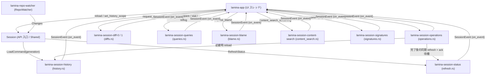
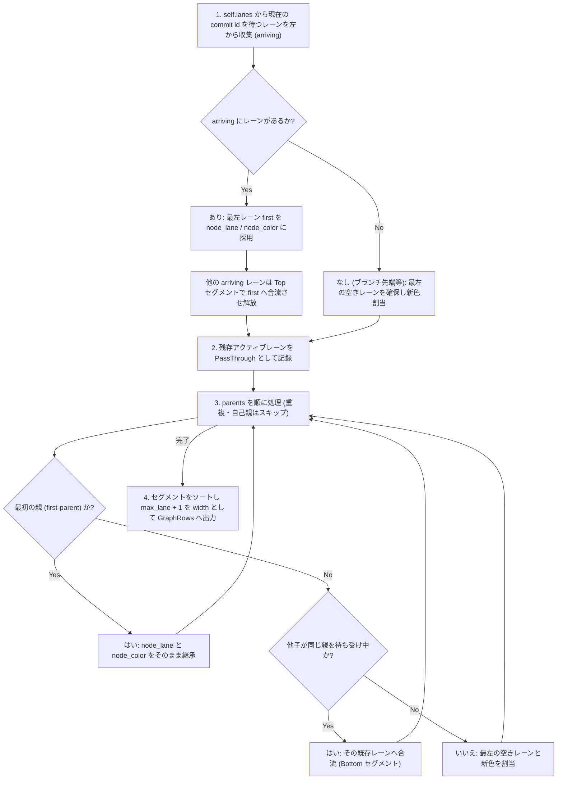

# `lamina-core` モジュール設計

`crates/lamina-core` は Lamina の UI 非依存コアライブラリである（`crates/lamina-core/src/lib.rs`）。外部の非同期ランタイムに依存せず、標準ライブラリのスレッドとチャネルを中心に構成される。読取は `gix`（`repo/`）、書込は外部 `git` CLI（`git_cli/`）へ分離し、それらを `session/` が調停して不変スナップショットとして UI へ供給する。

---

## 1. 共通型・エラー型（`types.rs`, `error.rs`）

### 責務
UI とコア各モジュール間で受け渡すデータモデル（`crates/lamina-core/src/types.rs`）および統一エラー型（`crates/lamina-core/src/error.rs`）を提供する。

### 主要な型
- `Oid`: `gix::ObjectId` の再エクスポート。
- `CommitInfo`: コミット一覧表示用の軽量所有型（`id`, `parents`, `summary`, `author_name`, `author_email`, `author_time`, `committer_time`, `shallow_boundary`）。
- `RefKind` / `RefInfo` / `HeadInfo`: ブランチ・タグおよび HEAD の状態（`Branch { short_name, target }` または `Detached { target }`）。unborn ブランチでは `target` が `None` になる。
- `ChangeKind` / `FileChange` / `WorktreeStatus`: 差分・ステージング状態（`staged` と `unstaged` の 2 分割）。
- `TreeEntryKind` / `TreeEntry`: ツリーブラウザ用のエントリ表現（`File`, `Directory`, `Symlink`, `Submodule`）。
- `StashInfo` / `ReflogKind` / `ReflogEntry` / `RemoteInfo` / `UpstreamInfo` / `RepoState` / `ConflictEntry` / `CommitStat`。
- `Error` / `Result<T, E = Error>`: `Io`, `Gix`, `GitCommand`, `NotARepository`, `Other`。

### 設計上の判断・制約
- `ReflogKind::parse` は Git 自身が生成する定型プレフィックス（`"commit (amend)"`, `"checkout: moving from "`, `"rebase (finish)"` 等）をリテラル一致で分類し、マッチしないものは `ReflogKind::Other` として生メッセージ表示へ回す（推測による誤分類を避けるため）。
- `Error` は機能別バリアントを持たず、`GitCommand` のみ引数・終了コード・`stderr` を構造化して保持する。

---

## 2. リポジトリ読取層（`repo/`）

`crates/lamina-core/src/repo/` は `gix::ThreadSafeRepository` を保持する `Repo`（`repo/mod.rs`）を起点とし、各サブモジュールで読み取り機能を分担する。`Repo` は `Clone` が低コストでスレッド間共有可能であり、`CommitDiffCache`（`Arc<Mutex<CommitDiffCache>>`）を共有してコミット行数統計（`stat.rs`）と変更ファイル一覧の重複ツリーウォークを防ぐ。

| サブモジュール | 責務・主要型 / 関数 | アルゴリズム・性能上の工夫と制約 |
| --- | --- | --- |
| `repo/mod.rs` | `Repo::open`, `workdir`, `git_dir`, `working_tree_encoding` | `attributes_only` で `.gitattributes` の `working-tree-encoding` を取得。index が無い bare リポジトリでは `None` にフォールバックする |
| `repo/log.rs` `repo/log/walk.rs` `repo/log/path.rs` | `CommitWalk`, `walk_commits_with`, `walk_commits_from_refs_with`, `PathWalk`, `Shallow` | `gix` 標準の topological walk は走査完了まで最初の 1 件を返さないため、独自の増分ウォーク（`walk.rs`）を実装。commit-graph の generation number で先行入次数パスを制限し、最新コミットから即座に yield しつつ `--date-order`（`DateKey`: `(committer_time, Reverse<insertion_order>, node)`）を維持する。`refs/notes/` や `refs/bisect/` 等の内部名前空間はレーン肥大化を防ぐため除外。`shallow_commits()` で境界を検出し `shallow_boundary` を付与する |
| `repo/commit_graph.rs` | `CommitGraphAdvice`, `CommitGraphFacts`, `CommitGraphThresholds` | ウォーク準備時間（既定 `DEFAULT_MIN_WALK = 500ms`）と未カバーコミット数（`DEFAULT_MIN_COMMITS = 50_000`, `STALE_FRACTION = 5`）から `Missing` / `Stale` を判定し、UI へ `git commit-graph write` の提案通知のみを出す（自動書込はしない） |
| `repo/bloom.rs` | `CommitGraphBloom`, `BloomKeys` | `gix-commitgraph` が未対応の `BIDX` / `BDAT` チャンク（changed-path Bloom filter）を直接読み取る。Murmur3（`SEED0`, `SEED1`）でパスを検査し、非 ASCII・切り詰め（`0xff`）・欠損・非 v1 レイヤーでは安全側（`true` = 変更あり得る）に倒してツリー比較へフォールバックする |
| `repo/history.rs` | `PathHistory`, `PathHistoryEntries` | `PathWalk`（`log/path.rs`）と `CommitGraphBloom` を組み合わせて特定パス・ディレクトリの履歴を辿る。`PathWalk` は全到達グラフを保持せず入次数カウンタのみを持ち、commit-graph がある場合は密な `u32` `Position` で参照してメモリ使用量を抑える |
| `repo/renames.rs` | `renames::apply`（ツリー変更リスト上のリネーム検出） | `CommitDiffCache` の 1 回のツリーウォーク結果を行数集計とファイル一覧で共有するため実装。同一 blob ID の即時ペアリングに加え、準備済み blob キャッシュ、サイズ比・行ハッシュ多重集合交差による事前絞り込み、最大スコア確定時の早期打ち切り、共通先頭/末尾行の事前除去により大規模マージでの比較回数を抑える |
| `repo/blame.rs` | `Blame`, `BlameCommit`, `BlameHunk`, `Repo::blame_with` | `gix-blame` と `git blame --incremental`（`git_cli/blame.rs`）のハイブリッド。`gix-blame` は途中キャンセル不可・shallow 境界停止不可・深い履歴で低速という制約があるため、**shallow クローン**・**blob サイズ > `GIX_MAX_BLOB_BYTES` (64 KiB)**・**第一親深さ > `GIX_MAX_DEPTH` (256)** のいずれかで `git` CLI へ切り替える（LFS ポインタ解決にも対応） |
| `repo/content_search.rs` | `ContentSearchQuery`, `ContentSearchMode` (`-S` / `-G`), `ContentSearchProgress` | `PathWalk` 順に第一親とのツリー差分を走査して文字列・正規表現マッチを検索。キャンセルチェックと進捗報告に対応 |
| `repo/status.rs` | `Repo::status`, `Repo::status_incremental` | `gix` の `status()` で `TreeIndex`（`staged`）と `IndexWorktree`（`unstaged`）を分離。コンフリクト項目は二重表示を避けるため `staged` 側から除去し `unstaged` の `Conflicted` に一本化。変更パス数 <= `MAX_INCREMENTAL_PATHS` (1000) かつ `.gitignore` / `.gitattributes` / `.gitmodules` やリポジトリルートを含まない場合は差分パスのみ再計算して前回結果へマージする |
| `repo/conflicts.rs` `repo/in_progress.rs` | `RepoState`, `ConflictEntry`, `InProgressDetails`, `RebaseOnto` | `MERGE_HEAD`, `rebase-merge`, `rebase-apply`, `CHERRY_PICK_HEAD`, `REVERT_HEAD`, `BISECT_LOG`, `AM` 等の状態・進行中コミット・リベース先情報を読み取り、マージ設定から `ConflictStyle` を解決する |
| `repo/compare.rs` `repo/range.rs` | `Comparison`, `CompareMode` (`TwoDot` / `ThreeDot`), `SelectionRange`, `plan_selection_range` | 任意 2 コミットのツリー比較（`ThreeDot` は `merge_base` 起点）、先後コミット数算出、複数選択コミット範囲の比較計画（隣接・不連続・起点解釈）を行う |
| `repo/config.rs` | `GitConfig`, `ConfigEntry`, `ConfigLayer`, `ConfigOrigin`, `WELL_KNOWN_KEYS`, `validate_key_name` | ローカル・グローバル・システム・`includeIf` を含む実効設定値を、定義元ファイルパス・行番号・条件付きインクルード情報とともに読み取る（書込は一切行わない） |
| `repo/stat.rs` | `CommitStat`, `CommitDiffCache` | コミットと第一親（または空ツリー）間の追加・削除行数を集計。バイナリや LFS ポインタは行数計算対象外とする |
| `repo/tree.rs` | ツリーエントリ一覧・blob 読込 | コミット時点のディレクトリ一覧とサイズ取得（LFS ポインタ検出含む） |
| `repo/message.rs` | コミット・マージメッセージ読取 | コミットメッセージ全文および `MERGE_MSG` 等の取得 |
| `repo/reflog.rs` | `ReflogEntry` | `HEAD` と各ローカルブランチの reflog を最新順・上限付きで読み取る |
| `repo/remotes.rs` `repo/upstream.rs` | `RemoteInfo`, `UpstreamInfo`, `UpstreamTarget` | リモート設定一覧および各ローカルブランチの tracking ブランチと ahead/behind 件数を算出 |
| `repo/submodules.rs` `repo/worktrees.rs` | `SubmoduleInfo`, `SubmoduleStatus`, `WorktreeInfo` | サブモジュール状態と linked worktree 一覧の取得 |
| `repo/lfs.rs` | リポジトリ内 LFS 解決 | `common_dir` と blob からの `LfsPointer` 解決 |
| `repo/signature.rs` | `CommitSignature`, `SignatureFormat`, `SignatureValidity`, `classify_signature_armor` | コミットヘッダの `gpgsig` / `gpgsig-sha256` と armored ブロック種別（GPG / SSH / X.509）を `gix` で高速判定。検証自体は `git_cli/signature.rs` が行う |

---

## 3. `git` CLI 実行層（`git_cli/`）

`crates/lamina-core/src/git_cli/` は `Git` ハンドル（`git_cli/mod.rs`）を中心に、外部 `git` バイナリ（最低要件 `MIN_GIT_VERSION = (2, 30, 0)`: `--pathspec-from-file`, `restore --staged`, `switch` が必要）を呼び出す。

### 共通実行基盤（`git_cli/mod.rs`）
- **環境固定**: 常に `GIT_TERMINAL_PROMPT=0` と `LC_ALL=C` を注入し、読取補助コマンドには `GIT_OPTIONAL_LOCKS=0` を付与してバックグラウンド実行による `index` の mtime 更新（不要なファイル監視発火）を抑止する。
- **Windows 対応**: `CREATE_NO_WINDOW` (`0x0800_0000`) でコンソール画面のちらつきを防止し、対象パス数が `MAX_INLINE_PATHSPECS` (64) 超または合計バイト長 `MAX_INLINE_PATHSPEC_BYTES` (8 KiB) 超の場合は `--pathspec-from-file=- --pathspec-file-nul` へ切り替えて 32 KiB コマンドライン上限を回避する。
- **安全性**: `checked_ref` が先頭 `-` で始まる文字列を拒否し、参照名が CLI オプションとして解釈される引数インジェクションを防ぐ。`stdin` 供給時は出力パイプ詰まりによるデッドロックを避けるため別スレッドで書き込む。`run_output_cancellable` は外部キャンセル関数が `true` になった時点で子プロセスを `kill()` する。

### サブモジュール一覧
- **`git_cli/ops.rs`**: ステージ・アンステージ（`add`, `restore --staged`, `rm`）、破棄（`restore`, `clean` — 長いパスリストはチャンク分割）、`commit`（`-F -` で標準入力からメッセージ渡し）、`checkout` / `switch`、ブランチ作成・削除・リネーム・upstream 設定、タグ操作、stash 作成・適用・削除、`apply_commit` 等。
- **`git_cli/history.rs`**: `cherry-pick`（`CherryPickOutcome` でコンフリクト停止や空コミットを終了コード・stderr から判別）、`revert`、`reset`（`--soft` / `--mixed` / `--hard`）、および `ContentHash` 検証付きのコンフリクト周辺操作。
- **`git_cli/merge.rs`**: `merge`、続行・中止、コンフリクト解決（`resolve_with_content` は対象パスがワークツリー外へのシンボリックリンク・パストラバーサルでないか検証した上で `ContentHash` による競合チェックを行い、`git add` する）。
- **`git_cli/rebase.rs`**: インタラクティブリベース計画（`RebaseStep`, `RebaseAction`: `Pick` / `Reword` / `Squash` / `Fixup` / `Drop` 等、`drop_commit`, `move_commit`, `reword_commit`, `squash_commit_into_parent`）。`GIT_SEQUENCE_EDITOR` に一時スクリプト/ファイルコピーを差し込み、`Reword` は `exec git commit --amend -F <file>` を計画へ埋め込む。`--empty=stop` を指定し、ダーティなワークツリーおよびマージコミットを含む操作は事前に拒否する。
- **`git_cli/manage.rs`**: リモートの追加・削除・URL 変更、ワークツリーの追加・削除・移動、サブモジュールの init/update、`git commit-graph write`。
- **`git_cli/clone.rs`**: `clone_repository`, `init_repository`。Windows で `canonicalize` が返す `\\?\` プレフィックスを除去し、進捗ストリームと askpass チャネルに対応する。
- **`git_cli/config.rs`**: `ConfigPreview` / `ConfigChange` / `ConfigTarget` / `ConfigWrite` による設定のプレビューと適用。対象ファイルのタイムスタンプ・サイズを保持する `FileStamp` により、プレビューから適用までの間に外部編集が入った場合は適用を中止して競合上書きを防ぐ。`--unset` 時の正規表現特殊文字は POSIX ERE 形式でエスケープする。
- **`git_cli/reflog.rs`**: Reflog ベースの安全な Undo 計画（`UndoPlan`, `UndoStep`, `SwitchTarget`）。`git reset --keep` や `git switch` を用い、すでにリモートへプッシュ済みのコミットを巻き戻す操作や、ダーティな作業ツリーと衝突するパスがある場合は安全のため拒否する。
- **`git_cli/progress.rs`**: `fetch_with_progress`, `fetch_unshallow_with_progress`, `pull_with_progress`, `push_with_progress`。`--progress` 付きで stderr をストリーミング購読し、`progress_percent` で進捗率（`u8`）を抽出する。
- **`git_cli/command_log.rs`**: `CommandLog`（リングバッファ上限 `MAX_LOG_ENTRIES = 500`）と `CommandRecord`。出力はメモリ膨張を防ぐため `MAX_CAPTURE_BYTES = 64 KiB`（UTF-8 文字境界安全切り詰め）に制限し、購読コールバックはデッドロック防止のため Mutex ロック解放後に呼び出す。
- **`git_cli/blame.rs` / `signature.rs` / `lfs.rs`**: 読取系から呼び出される CLI 連携。
  - `blame.rs`: `git blame --incremental` を起動し、`PROGRESS_BATCH_HUNKS = 500` 件または `PROGRESS_BATCH_INTERVAL = 100ms` ごとにチャンクを通知。`core.quotepath=false` および C 言語風エスケープパスのアンエスケープ、隣接ハンクの結合を行う。
  - `signature.rs`: `git log --no-walk=unsorted --stdin -z` で未検証コミットのみ一括検証し、`%G? = N` が返った場合も `repo/signature.rs` 側で署名ヘッダが既知なら `SignatureValidity::CannotCheck` として鍵不足ヒント（`gpg.ssh.allowedSignersFile` 等）を返す。
  - `lfs.rs`: `git lfs version` や `git lfs locks --json` 等を実行する。

---

## 4. セッション調停層（`session/`）

`crates/lamina-core/src/session/` は UI からの操作・要求を受け取り、9 種類（ワーカー 10 スレッド構成）のバックグラウンドスレッドとファイル監視を統括して不変スナップショット `RepoSnapshot` と `SessionEvent` を発行する。

- **`session/mod.rs` & `publish.rs`**:
  - `Shared` は `RwLock<Arc<RepoSnapshot>>` と `publish_lock: Mutex<()>` を持ち、履歴チャンク更新・ステータス更新・`busy` 切替時に古い `generation` の書込が新しい世代を上書きしないよう直列化する。イベント送出は常にロック外で行う。
  - `CommitList` は `COMMIT_CHUNK = 4096` 件ごとの `Arc<CommitChunk>` スライスで構成され、部分チャンクへの追記時のみ末尾チャンクをコピーする。
- **`session/history.rs`**:
  - 初回だけ `FIRST_COMMIT_CHUNK = 200` 件で早期公開し、その後は `COMMIT_CHUNK = 4096` ごとに公開する。
  - コミット ID から行番号を引く `commit_index`（`HashMap<Oid, usize>`）は毎回再構築すると高コストなため、0 件目・`16_384 * 4^k` 件到達時・ウォーク完了時の指数間隔でのみ更新する。
  - ウォーク準備時間を計測し、`CommitGraphAdvice` が得られれば `SessionEvent::CommitGraphSuggested` を送出する。
- **`session/refresh.rs`**:
  - キュー内の連続した `RefreshStatus` を 1 回分に結合（`merge_paths`）してから実行する。ベースラインあり・`SAFETY_FULL_SCAN_INTERVAL` (30秒) 以内・パス数上限内なら `Repo::status_incremental`、そうでなければフルスキャンを実行する。`config` フラグがある場合は `remotes` と `upstreams` も再読込する。
- **`session/operations.rs`**:
  - `Operation` を 1 つずつ直列実行する。実行中は `operation_active` フラグと `snapshot.busy` を立て、その間に届いた監視イベントは `PendingRefresh` に集約して完了後に掃き出す。完了後は `status`（必要に応じ `history`）の完了 `ack` を最大 `REFRESH_TIMEOUT` (60秒) 待ってから `busy` を解除し `OperationFinished` を発行する。進捗通知は `PROGRESS_INTERVAL` (50ms) で間引きつつ最終行を確実に配送する。
- **`session/diffs.rs`**:
  - 共有キューを 2 スレッド（`DIFF_WORKERS = 2`）で処理。画像ファイルのメタデータ差分（`image.rs`）、LFS ポインタ解決（テキスト差分用はサイズ上限あり）、`decode_for_display`、SVG プレビュー、テキスト差分（`diff/`）を計算する。まず構文ハイライトなしの `DiffReady` を即座に返し、続いて `highlight/` による `LineHighlights` 付き結果を再送することで体感応答性を高めている。
- **`session/queries.rs`, `blame.rs`, `content_search.rs`, `signatures.rs`**:
  - 検索、パス履歴（スナップショット索引とストリーミング双方）、コミット統計、2コミット比較、サブモジュール/ワークツリー、進行中詳細、reflog、blame、コンテンツ検索、署名検証をそれぞれ担当する。`QueryState` で発行済み `QueryTicket` のキャンセル集合を管理し、`signatures.rs` は単一ワーカー + エポック番号管理の `SignatureCache` によってリロード後の古いキャッシュ汚染を防ぐ。

---

## 5. コミットグラフレイアウト（`graph/mod.rs`）

`crates/lamina-core/src/graph/mod.rs` はトポロジカル順（最新コミット先頭）に並んだコミット列を 1 行ずつ逐次処理（`GraphLayout::push`）し、描画用の幾何情報 `GraphRows` を構築する。

### 幾何モデルとストレージ最適化
- 各行（`GraphRow<'a>`）はノード位置 `(node_lane, node_color)`、必要な横幅 `width`、`passes: &[PassThrough]`、`edges: &[Segment]` からなる。
- 1 行を上下半分（`Half::Top` / `Half::Bottom`）に分けて表現する。素通りするだけの縦線を行ごとに `Top` + `Bottom` の 2 つの `Segment`（計 16 bytes）で表す代わりに、4 bytes の `PassThrough { lane, color }` として格納する。
- 全行を 1 つの `GraphRows` のフラット配列（`rows: Vec<RowMeta>`, `passes: Vec<PassThrough>`, `edges: Vec<Segment>`）へ詰め、さらに 2-way セットアソシアティブキャッシュ `pass_cache`（`4096` セット × 2 ウェイ = 128 KiB）によって直前行と同一の `passes` スライスを再利用・重複排除する。これは長大な履歴で数十本のレーンが並走する際のヒープ消費量を大幅に削減するためである（`shrink_to_fit()` 時にキャッシュは解放される）。

### レーン割り当てアルゴリズム（`GraphLayout::push`）

- **第一親（first-parent）の連続性**: マージや通常コミットの第一親には必ず `node_lane` と `node_color` を引き継ぐため、メインラインが縦一直線かつ同色で保たれる。
- **空きレーンの即時再利用**: ステップ 2 で `PassThrough` を収集した直後（まだステップ 3 の親レーン割り当て前）に合流で解放されたレーンが空いているため、同じコミットの第二親以降の親がその空きレーンを即座に再利用でき、グラフの横幅膨張を抑えられる。
- **パレット回転**: `PALETTE = 8` 色を `color_cursor` でローテーションし、隣接線が区別しやすいようにしている。
- **スクラッチバッファ再利用**: `GraphLayout` 内部に `scratch_edges`, `scratch_passes`, `scratch_arriving`, `scratch_parents` を保持し、行ごとの Vec アロケーションをゼロに抑えている。
- **制約**: 行単位のストリーミング確定方式であるため、後から合流するブランチのために遠い将来の状態を見てレーンを事前予約するような大域最適化は行わない。`render_ascii` と `expanded_segments` はテストおよびスナップショット検証用に提供される。

---

## 6. 差分・部分パッチ生成（`diff/`, `patch/`）

### `diff/`（`mod.rs`, `lines.rs`, `expand.rs`, `emphasis.rs`）
- **生バイト単位の比較（`diff/mod.rs`, `diff/lines.rs`）**:
  `diff_bytes` はテキストを先に UTF-8 デコードせず、生バイト列のまま `imara-diff`（`Algorithm::Histogram` + `postprocess_lines`）へ渡す。トークン内部に `\r\n` / `\n` を含めることで改行コード差分を正確に検出しつつ、表示用 `content`（`decode_for_display` で変換）からは末尾の改行記号を取り除く。これにより Shift_JIS 等を含むファイルの差分も破損せず扱える。
- **ギャップ展開（`diff/expand.rs`）**:
  ハンク間の省略箇所を `Gap` / `GapView` として表現し、`REVEAL_STEP = 20` 行単位またはファイル全体の段階的展開を行う。極大ファイルでのメモリ消費を防ぐため、`MAX_EXPAND_BYTES = 1 MiB` を超えるファイルでは展開を無効化する。
- **単語単位強調（`diff/emphasis.rs`）**:
  ハンク内の連続した `Removed` / `Added` ペアに対して二次的に単語・トークンレベルの `Histogram` 差分を取り、行内ハイライト範囲を算出する。長大行や全く別内容の書き換えで誤強調・CPU 負荷が出ないよう、`MAX_LINE_BYTES = 1000`、`MAX_CHANGED_SHARE = 0.6`、サイズ不等時の `MIN_PAIRED_SIMILARITY = 0.5` を閾値として採用し、条件外では強調を省略する。

### `patch/`（`mod.rs`）
- **バイト保存型の部分ステージ・アンステージ・破棄**:
  `RawFileDiff` / `BytePatchFile` / `LineSelection` / `PatchMode` を用い、選択されたハンクまたは行のみを含む Unified Diff パッチ（`build_patch_bytes`）を組み立てて `git apply --cached`（または逆適用・作業ツリー破棄）へ渡す。
- 元のバイト列をそのまま切り出すため、Shift_JIS や EUC-JP などの非 UTF-8 ファイルの部分ステージを行ってもエンコーディングが UTF-8 に書き換わらない。
- 一部行のみを選択した場合、`PatchMode`（ステージ／アンステージ／破棄）に応じて「選択されなかった削除行をコンテキスト行へ変換」「選択されなかった追加行を除外」し、さらに各ハンクの開始行番号（post-image 座標）を前方の適用結果に合わせて補正する。

---

## 7. 3-way マージ解析（`merge.rs`）

- **責務**: コンフリクトファイルの 3 者（`base`, `ours`, `theirs`）を解析し、ハンク単位の解決状態とプレビュー・出力バイト列を生成する（`MergeAnalysis::analyze`）。
- **設計上の判断**: `gix` はコンフリクト箇所の base/ours/theirs 行範囲を直接返さないため、`imara-diff` を用いて独自の 3-way diff3 解析を実装している。
- **機能と制約**:
  - `ConflictStyle`（`Merge`, `Diff3`, `ZealousDiff3`）に対応し、Git の `merge.conflictStyle` 設定と整合するマーカー展開を行う。
  - 元ファイルの `LineEnding`、ファイル末尾改行の有無（`trailing_newline`）、および `TextEncoding` を保持したまま書き戻す（UTF-16 の NUL バイト列を誤ってバイナリと判定しないよう専用判定を持つ）。
  - 外部エディタ等による同時編集でユーザーの変更を上書きしないよう、FNV-1a ベースの `ContentHash` を保持して書込前検証を行う。

---

## 8. 構文ハイライト（`highlight/mod.rs`）

- **責務**: 差分ビューやファイルビュー向けの行単位構文ハイライト `LineHighlights` を生成する。
- **実装**:
  - `tree-sitter`（`0.27.2`）と 15 言語（Rust, JavaScript, TypeScript, TSX, Python, Go, JSON, TOML, YAML, CSS, HTML, Bash, C, C++, Markdown）の文法を同梱する。バイナリサイズとビルド時間・実行時負荷を抑えるため、injection や locals クエリは省略している。
  - キャプチャ名（例: `keyword.control.flow`）は `CAPTURE_KINDS` テーブルに対して最長ドット境界プレフィックス一致で `HighlightKind` へマッピングする。
  - 複数行にまたがるトークン（ブロックコメントや複数行文字列リテラル）は改行位置で各行のスパンへ分割する。
  - `Highlighter` 内部で言語ごとの `HighlightConfiguration` をキャッシュし（`Send` 対応）、`MAX_SOURCE_BYTES = 2 MiB` を超えるファイルや解析エラー時はパニックせずハイライトを省略して平文フォールバックする（UI 側の diff 計算等ではさらに 1 MiB 制限等を併用）。

---

## 9. エンコーディングと表示幅（`encoding.rs`, `text.rs`）

- **`encoding.rs`**: `TextEncoding`（`encoding_rs::Encoding` の `Copy` ラッパー）と `decode_for_display` を提供。判定順は **BOM → 厳密な UTF-8 → `.gitattributes` の `working-tree-encoding`（非 UTF-8 時のみ遅延評価）→ `chardetng`（`Iso2022JpDetection::Allow`, `Utf8Detection::Deny`）**。デコード時に不正バイト列は `U+FFFD` へ置換する。マージエディタからの書戻し向けに `TextEncoding::encode` を備え、`encoding_rs` がエンコード非対応の UTF-16LE/BE については BOM 付きで自前エンコードする。
- **`text.rs`**: `unicode-width` を用いた `display_width` と `truncate_width` を提供。日本語の全角文字、結合文字、絵文字を含む文字列を列幅基準で正確に切り詰める。

---

## 10. 認証ブリッジ（`askpass.rs`）

- **責務**: GUI から実行するリモート操作（`clone`, `fetch`, `pull`, `push` 等）で `git` が認証プロンプトを求めた際、対話端末なしに UI へ問い合わせて応答を返す。
- **構造とセキュリティ**:
  - `AskpassHost::start`: コマンド実行期間中のみ一時的な IPC サーバーを起動。Unix 系 OS では `0o700` 一時ディレクトリ内の Unix ドメインソケット、Windows では `127.0.0.1:0` の TCP リスナを開く。
  - ヘルパープロセス（`lamina --askpass <prompt>` → `helper_main`）は `ENDPOINT_ENV` とワンタイムトークン `TOKEN_ENV` を受け取り、`lamina-askpass/1` プロトコルでプロンプトを転送する。
  - `is_secret` はプロンプト文字列（`"password"`, `"passphrase"`, `"passwd"`, `"pin "`, `"secret"`, `"token"`）からマスク表示の要否を判定する。
  - 通信プロトコル保護のため長さ上限（`MAX_PROMPT_BYTES = 4096`, `MAX_ANSWER_BYTES = 8192`, `MAX_HEADER_BYTES = 512`）と I/O タイムアウト（`IO_TIMEOUT = 10s`, `HELPER_RESPONSE_TIMEOUT = 150s`）を設け、回答を包む `Answer` 型は `Drop` 時にバッファをゼロクリアし、ディスクや `CommandLog` には一切記録しない。

---

## 11. Forge 連携（`forge/mod.rs`, `forge/gh.rs`）

- **責務**: ブランチに紐づく Pull Request の一覧・ステータスチェック・レビュー状況の取得とチェックアウトを提供する（`ForgeCli` トレイトと `Gh` 実装）。
- **設計上の工夫・制約**:
  - `gh pr list --state all --limit 100 --json ...` の 1 回の呼び出しで全ブランチ分をまとめて取得し、JSON パースは純粋関数として分離してネットワーク不要でテスト可能にしている。
  - `GH_PROMPT_DISABLED=1` と `TIMEOUT = 15s`（タイムアウト時は強制終了）、および stdout/stderr の並列ドレインスレッドにより、未認証やハングした `gh` プロセスがワーカースレッドを固めない設計になっている。
  - チェックアウト時はブランチ名ではなく PR 番号（`gh pr checkout <number>`）のみを渡し、ブランチ名によるオプション解釈リスクを排除している。`LIST_LIMIT = 100` を超える PR は一覧されない制約がある。

---

## 12. ユーティリティ・補助モジュール（`lfs.rs`, `tools.rs`, `image.rs`, `watch.rs`）

- **`lfs.rs`**: Git LFS ポインタファイル（`MAX_POINTER_BYTES = 1024` 以下の仕様形式）をパースする `LfsPointer::parse`、ローカルオブジェクトパス解決（`<common_dir>/lfs/objects/aa/bb/<hex>`）、差分両側の解決を行う `resolve_diff`、`git lfs locks --json` 出力のパーサ `parse_locks_json` を提供。
- **`tools.rs`**: 外部ツール（`ghq`, `gh`）の検出、クローン先パスの解決（`ghq_destination`）、リモート URL からのブラウザリンク生成（`GitHubRemote::parse`）。ホスト誤認を防ぐため、許可ホストは `github.com` と `gh auth status` から取得した既知ホスト集合に明示的に限定している。
- **`image.rs`**: PNG / GIF / JPEG / BMP / ICO / WebP / SVG のヘッダバイト列のみからピクセル寸法とフォーマット情報（`ImageFormat`）を抽出する（ピクセルデコードを行わない軽量実装、上限 `MAX_IMAGE_BYTES = 20 MiB`）。SVG は `ImageKind::Svg` としてテキスト差分とプレビュー表示の両方を可能にする。
- **`watch.rs`**: `RepoWatcher` と `Changes`。`notify::recommended_watcher` からの生イベントを専用ワーカースレッド `lamina-repo-watcher` へ流し、`LEADING_SETTLE` (30ms) / `debounce` (150ms) / `MAX_LATENCY` (1s) の 3 パラメータでバースト集約を行う。バッチごとに `gix::Repository::excludes` スタックを生成して `.gitignore` 対象ファイルのイベントを除外し、`MAX_PATHS = 1000` 超過やオーバーフロー・ignore/attributes 変更時は `rescan = true` を立てて安全にフルスキャンへ倒す。また Drop 時は macOS FSEvents の停止待ちハングを避けるため、ワーカー join 後にプラットフォームバックエンドを別スレッドで破棄する。
