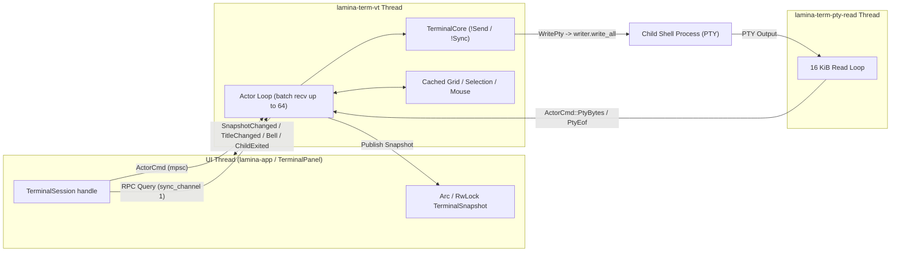

# 埋め込みターミナル設計 (`lamina-term` / ターミナルパネル)

本書は Lamina の埋め込みターミナル機能の設計を解説する。バックエンドとなる VT エミュレーション・PTY 管理クレート `crates/lamina-term` と、UI 統合を担う `crates/lamina-app` 側のパネルおよびグリッド描画コンポーネントの構成・制約を扱う。上位アーキテクチャおよびコア層については [設計ドキュメント一覧](README.md)・[アーキテクチャ概要](architecture.md)・[コア設計](core.md) を参照。

---

## 1. ライブラリ選定の背景 (`libghostty-vt` + `portable-pty`)

Lamina は軽量・高速なクロスプラットフォーム git クライアントであり、リポジトリやワークツリーを離れずに git フック確認や補助コマンドを実行できるよう、タブ単位の埋め込みターミナルを備える。VT パーサと PTY 抽象化の選定基準と設計上の判断は以下の通りである。

### 1.1 `libghostty-vt` を採用した理由

- **安定した C ABI (1.0 系)**: ターミナル状態 (`Terminal`)、描画差分 (`RenderState`)、キー・マウスエンコーダ (`KeyEncoder` / `MouseEncoder`)、テキスト整形 (`Formatter`) が不透明ハンドルベースの C ABI として安定提供されている (`crates/lamina-term/src/sys.rs`)。
- **高品質な VT エミュレーションとエンコーディング**: Unicode 幅計算・グラフェム処理、SGR 属性・RGB/パレットカラー、代替スクリーンバッファ、DEC モード (ブラケットペースト 2004、フォーカス報告 1004、代替スクロール 1007、DECCKM 等) および拡張キーボードプロトコルや `modifyOtherKeys` に対応したエンコーディングを一貫してライブラリ側へ委譲できる。
- **Dirty 追跡の標準サポート**: 行・セル単位の dirty フラグと行イテレータを備えており、スナップショット生成時に変更行のみを再構築して UI スレッドへのコピー量を抑えられる。
- **寛容なライセンス**: `libghostty-vt` および `portable-pty` とともに、Lamina のワークスペースライセンス (`MIT OR Apache-2.0`) と矛盾なく組み込める。

### 1.2 クレート分離と薄い内部 FFI

- **GPUI 非依存の設計**: `crates/lamina-term/Cargo.toml` はランタイム依存として `portable-pty` (`0.9`) と Unix のみ `libc` (`0.2`) だけを持ち、`gpui` / `gpui-platform` はベンチマークやウィンドウ付きサンプルを動かすための `[dev-dependencies]` に限定されている。これにより VT/PTY ロジックを純粋な Rust ライブラリとしてヘッドレスで単体テストできる。
- **外部 `-sys` クレートを使わない理由**: `crates/lamina-term/src/sys.rs` に必要最小限の `extern "C"` 宣言・定数・不透明型ラッパーを直接配置している。クレート側でピン留めしたヘッダ定義と 1 対 1 に保つことで、ビルド時にバインディング生成ツールチェインへ依存せず、ABI の食い違いを防いでいる。

---

## 2. ビルドシステムと静的リンク (`crates/lamina-term/build.rs`)

`crates/lamina-term` は `libghostty-vt` を外部のシステムライブラリに頼らずビルド時に静的ライブラリとして組み込む設計になっている。すべての中核ロジックは `crates/lamina-term/build.rs` に実装されている。

### 2.1 ピン留めされたソース・依存と Zig ツールチェイン

- **バージョンとチェックサムのピン留め**: `LIBGHOSTTY_VT_VERSION = "1.0.1"` と `REQUIRED_ZIG_VERSION = "0.17.1"` が固定されており、ソース tarball (`libghostty-vt-1.0.1.tar.gz`) と Zig パッケージキャッシュ tarball (`libghostty-vt-1.0.1-deps.tar.gz`) の SHA-256 ハッシュ (`SRC_SHA256`, `DEPS_SHA256`) をビルドスクリプト内で検証する。
- **Zig バージョン検証**: `zig version` (環境変数 `ZIG` でパス上書き可能) の出力が `0.17.1` と完全一致することをビルド開始時に強制し、ツールチェイン差異によるビルド破壊を防ぐ。

### 2.2 ダウンロード・ビルド・キャッシュ階層

1. **キャッシュルート決定**: `CARGO_TARGET_DIR` (未設定時は `OUT_DIR` から親へ辿る target ディレクトリ) 配下に `ghostty-vt-cache/` を構成する。
   - `downloads/`: `curl` (Windows では `curl.exe`) で取得した tarball の格納先。すでに同一ファイルが存在すれば SHA-256 を検証し、破損時のみ再取得する。
   - `prebuilt/1.0.1-<optimize>-<target>/`: `<optimize>` (`LIBGHOSTTY_VT_OPTIMIZE` またはデフォルト `ReleaseFast`) とコンパイルターゲットの組み合わせごとにビルド済み静的ライブラリ (`libghostty-vt.a` または `ghostty-vt-static.lib`) を保存する。
2. **原子的なキャッシュ配置**: `<prebuilt_dir>.<pid>.part` の一時ディレクトリで組み上げたあと `fs::rename` で確定配置するため、並列または中断されたビルドが半端なキャッシュを残さない。また `OUT_DIR/ghostty-vt-build.stamp` に `<version>:<optimize>:<target>` を記録し、`OUT_DIR` 内への再コピー要否を判定する。
3. **Zig キャッシュの隔離**: `zig build` 実行時には `ZIG_GLOBAL_CACHE_DIR` と `ZIG_LOCAL_CACHE_DIR` を `OUT_DIR` 配下の一時ディレクトリに固定し、`-Demit-lib-vt --prefix <OUT_DIR>/ghostty-vt-prefix --system <zig_deps> -Doptimize=<optimize> -Dcpu=baseline` (クロスコンパイル時は `-Dtarget=...` を付与) でオフラインビルドする。これによりシステムのグローバル Zig キャッシュ競合やキャッシュ不整合を回避する。

### 2.3 オフライン・パッケージャ向け環境変数

| 環境変数 | 役割 |
|---|---|
| `LIBGHOSTTY_VT_LIB_DIR` | ビルド済み静的ライブラリを含むディレクトリを指定する。設定されている場合、ダウンロードおよび Zig ビルドを完全にスキップする (Nix やオフラインパッケージング向け) |
| `LIBGHOSTTY_VT_SOURCE_DIR` | 展開済みソースツリーを直接指定する |
| `LIBGHOSTTY_VT_ZIG_SYSTEM_DIR` | 展開済み `--system` 依存パッケージディレクトリを直接指定する |
| `LIBGHOSTTY_VT_OPTIMIZE` | Zig の `-Doptimize` モードを上書きする (デフォルトは `ReleaseFast`) |
| `ZIG` | 使用する `zig` バイナリのパスを上書きする |

### 2.4 プラットフォーム別静的リンク

- **Unix (macOS / Linux)**: `cargo:rustc-link-lib=static=ghostty-vt` (`libghostty-vt.a`) を出力する。
- **Windows (MSVC 等)**: `cargo:rustc-link-lib=static=ghostty-vt-static` (`ghostty-vt-static.lib`) に加え、Zig 標準ライブラリが要求する `dylib=ntdll` と `dylib=kernel32` をリンクする。

---

## 3. `lamina-term` アーキテクチャ (`crates/lamina-term/src/`)

`crates/lamina-term` の公開ファサードは `TerminalSession` (`crates/lamina-term/src/terminal.rs`) であり、UI スレッドからは完全にスレッドセーフなハンドルとして扱える一方、内部の `libghostty-vt` ハンドル群は単一の専任スレッドへ閉じ込めている。



### 3.1 スレッドモデルと所有権境界

- **`TerminalCore` の `!Send` / `!Sync` 制約**: `libghostty-vt` の C オブジェクトはスレッド安全ではないため、`TerminalCore` (`crates/lamina-term/src/terminal.rs`) は `PhantomData<*const ()>` を持ち、`Send` も `Sync` も実装しない。`TerminalSession::spawn` / `spawn_with_callback` は `lamina-term-vt` スレッドを起動し、そのスレッド内部で `TerminalCore` を生成・所有・破棄する。
- **PTY リーダースレッド (`lamina-term-pty-read`)**: `portable_pty::native_pty_system()` で PTY ペアを開き、ログインシェル (`CommandBuilder::new_default_prog` による `$SHELL` / `%COMSPEC%`、または指定 `shell` / `shell_args`) を `TERM=xterm-256color`, `COLORTERM=truecolor` 付きで起動する。その後 `master.try_clone_reader()` を 16 KiB バッファで読み続け、`ActorCmd::PtyBytes` または EOF 時の `ActorCmd::PtyEof` を `mpsc::channel` で `lamina-term-vt` へ送る。
- **バッチドレインによるコアレッシング**: `lamina-term-vt` は `cmd_rx.recv()` で 1 件待機した後、キューに溜まっている後続コマンドを最大 64 件 (`MAX_BATCH = 64`) まで `try_recv()` でまとめて取り出して順次処理する。大量出力が発生した際、16 KiB チャンクごとに毎回スナップショット再構築と UI 再描画を起こすのではなく、1 バッチの最後にまとめて 1 回のスナップショット更新へ集約する。
- **同期 RPC チャネル**: スクロールバック行の読み出し (`read_scrollback_rows`) や選択テキスト取得 (`selected_text`) など戻り値が必要な問い合わせには、`mpsc::sync_channel(1)` の応答用チャネルを含む `ActorCmd` を送信して待機する。

### 3.2 `TerminalCore` の設定と C コールバック

`TerminalCore::configure` は起動時に以下を設定する (`crates/lamina-term/src/terminal.rs`)。

- **基本オプション**: `TerminfoName = "xterm-256color"`、スクロールバック上限 `4 MiB` (`max_bytes`) または 10,000 行 (`DEFAULT_SCROLLBACK_LIMIT`)、`TrackLastCell = true` (マウス座標の重複イベント抑制)。
- **Windows ConPTY 回避策**: `#[cfg(windows)]` では `ResizePullScrollback = false` を設定し、ConPTY 側の再折り返しと `libghostty-vt` 側のスクロールバック引き戻しが二重に作用して画面行がずれる現象を防ぐ。
- **ピン留めされたコールバック状態**: `Box<CallbackState>` としてヒープ上に固定アドレスで確保し、`Userdata` ポインタとして `libghostty-vt` へ渡す。以下の 3 コールバックのみを登録している。
  1. `WritePty`: DSR (`CSI 6 n`) や DA 問い合わせに対する応答バイト列を `pending_pty_writes` バッファへ積む。
  2. `TitleChanged`: 現在のウィンドウタイトル文字列を読み出し `pending_title` フラグを立てる。
  3. `Bell`: BEL (`\x07`) 受信フラグ `pending_bell` を立てる。

### 3.3 スナップショットモデルと Dirty 追跡 (`crates/lamina-term/src/snapshot.rs`)

UI が参照する状態は不変スナップショット `TerminalSnapshot` として `Arc<RwLock<TerminalSnapshot>>` で共有される。

- **データ構造**:
  - `cols`, `rows`: グリッド寸法。
  - `cells: Vec<CellSnapshot>`: 行優先 (`row * cols + col`) のフラット配列。各セルは `text: SharedCellText` (1〜2 コードポイント程度をヒープ確保なしで保持できる小文字列型)、`fg` / `bg` (`Rgb`)、`bold` / `italic` / `underline` / `strikethrough` / `dim` / `inverse` / `invisible`、`width: CellWidth` (`Narrow`, `Wide`, `SpacerTail`, `SpacerHead`) を持つ。
  - `cursor: CursorSnapshot`: `col`, `row`, `visible`, `style` (`Block`, `Bar`, `Underline`, `HollowBlock`), `blinking`, `has_wide_tail`, `color`, `password_input`。
  - `scrollbar: ScrollbarSnapshot`: `total_rows`, `viewport_offset`, `viewport_len`。
  - `selection: Option<SelectionSnapshot>`: ビューポート範囲にクリップされた各行の選択範囲と `is_rectangle`。
  - `alt_screen`, `title`, `exited`, `exit_code`。
- **増分構築 (`build_snapshot`)**:
  1. `ghostty_render_state_update` を呼び、最新の端末状態から描画状態へ反映する。
  2. `GhosttyRenderStateDirty` が `False` かつテーマ・選択状態の強制更新も不要であれば再構築をスキップする。
  3. 再構築時はまずテーマ・カーソル・スクロールバーを同期したうえで、`ghostty_render_state_row_iterator_next_dirty` を用いて**変更された行だけ**走査し、アクター内に保持する `cached_grid` の該当行スライスを上書きする。
  4. 走査完了後 `ghostty_render_state_clean` で dirty 状態をリセットする。
  5. 直前に配信した `last_published` と同値比較し、実際に変化があった場合のみ `Arc<RwLock<_>>` を更新して `TerminalEvent::SnapshotChanged` を通知する。

### 3.4 選択モデル (`crates/lamina-term/src/selection.rs`)

- **座標系 (`BufferPoint`)**: スナップショット時刻の `ScrollbarSnapshot::viewport_offset` を加算して、ビューポート座標 `(col, row)` をバッファ絶対行インデックスへ変換して保持する。これにより、選択中に新しい出力でスクロールが進んでも選択始点・終点が画面上の見た目ではなく論理行へ追従する。
- **文字・単語・行選択**: ドラッグによる範囲選択、ダブルクリックによる単語境界拡張 (`select_word`)、トリプルクリックによる論理行全体選択 (`select_line`) をサポートする。選択テキストの取得 (`selected_text`) は `ghostty_formatter_format_buf` に unwrap および末尾空白トリムオプションを与えて呼び出し、自動折り返し行を 1 行のテキストとして自然にコピーする。

### 3.5 キー・マウス・ペースト・フォーカスエンコーディング

- **キー入力 (`crates/lamina-term/src/keys.rs`)**: `KeyInput` (`TermKey`, `Modifiers`, `KeyAction`, UTF-8 テキスト等) を `ghostty_key_event` + `ghostty_key_encoder` へ渡し、端末の現在のモード (DECCKM、拡張キーボードプロトコルフラグ、`modifyOtherKeys` 等) に応じたエスケープシーケンスを生成して PTY へ書き込む。
- **マウス入力 (`crates/lamina-term/src/mouse.rs`)**: 押下中のボタン状態を追跡し、`MouseEncoder` への端末モード同期を必要なタイミングに限定することで、`TrackLastCell` の状態が不要にリセットされるのを防ぐ。またアプリケーション側がマウスレポートを有効化していない状態でホイールを受けた場合はローカルスクロールへ振り分け、通常画面では `ScrollAction::Delta` を発行、代替スクリーンかつ DEC 1007 が有効な場合は `ArrowUp` / `ArrowDown` シーケンスを 1 イベントあたり最大 `MAX_WHEEL_STEPS_PER_EVENT = 64` 回送信する。
- **ペースト・フォーカス (`crates/lamina-term/src/terminal.rs`)**: `encode_paste` は DEC 2004 (ブラケットペーストモード) を参照し、有効時は `\x1b[200~` ... `\x1b[201~` で囲むとともに、`libghostty-vt` のサニタイズ仕様に沿って安全でないエスケープ文字を無害化する。`encode_focus` は DEC 1004 が有効な場合のみ `\x1b[I` / `\x1b[O` を送出する。

### 3.6 プロセスライフサイクルと `Drop` 挙動

- **通常終了 (`PtyEof`)**: シェル終了によりリーダースレッドが EOF を検知すると、`ActorCmd::PtyEof` が送信される。アクターは最大 200 ms の範囲で `reap_child_after_eof` を試行して終了コードを取得し、`TerminalEvent::ChildExited` を発火する。
- **セッション破棄 (`TerminalSession::drop`)**: `ActorCmd::Shutdown` を送信したのち、`actor_thread` と `reader_thread` の双方を `join()` する。アクター側は `terminate_and_reap` を実行して `child.kill()` (Unix ではさらに `libc::kill(-pgid, SIGHUP)` に続けて `SIGKILL`) で子プロセスグループごと終了させて `child.wait()` を完了し、`writer` と `master` をドロップしてリーダースレッドの `read()` ブロッキングを確実に解除する。
- **`TerminalCore::drop`**: `ghostty_terminal_set` で登録済みコールバック関数と `Userdata` をすべてクリアしてから `Formatter`・`MouseEncoder`・`KeyEncoder`・`RenderState`・`Terminal` の各ハンドルを解放するため、破棄途中の C コールバックによる use-after-free が起こらない。

### 3.7 キー入力から描画までのシーケンス

```mermaid
sequenceDiagram
    participant User as "User / GPUI Window"
    participant Panel as "TerminalPanel (UI)"
    participant Actor as "lamina-term-vt Thread"
    participant PTY as "PTY / Child Shell"
    participant Grid as "TerminalGrid (Paint)"

    User->>Panel: "KeyDown (on_key_down / IME commit)"
    Panel->>Actor: "ActorCmd::Key(KeyInput)"
    Actor->>Actor: "KeyEncoder -> VT bytes"
    Actor->>PTY: "writer.write_all(bytes)"
    PTY-->>Actor: "lamina-term-pty-read: ActorCmd::PtyBytes"
    Actor->>Actor: "ghostty_terminal_vt_write (batch up to 64)"
    Actor->>Actor: "build_snapshot (dirty rows -> cached_grid)"
    Actor-->>Panel: "TerminalEvent::SnapshotChanged -> cx.notify()"
    Panel->>Grid: "prepaint / paint reads Arc<RwLock<TerminalSnapshot>>"
    Grid-->>User: "Draw cells, cursor, selection, IME preedit"
```

---

## 4. `lamina-app` との統合 (`terminal_panel/` と `ui/terminal_grid.rs`)

### 4.1 Cargo Feature と `RepoView` への配置

- **フィーチャーフラグ (`crates/lamina-app/Cargo.toml`)**: `terminal = ["dep:lamina-term"]` として定義され、`default = ["terminal"]` に含まれる。`--no-default-features` でビルドした場合はターミナルパネル関連コードが `#[cfg(feature = "terminal")]` で綺麗に除外され、`lamina-term` や Zig ビルドなしでもアプリ本体をコンパイルできる。
- **タブ単位の配置 (`crates/lamina-app/src/repo_view.rs`)**: 各リポジトリ・ワークツリータブの `RepoView` が `terminal: Option<Entity<TerminalPanel>>`, `terminal_open: bool`, `terminal_top_fraction: f32` (初期値 `DEFAULT_TERMINAL_TOP_FRACTION = 0.68`) を保持する。
  - `ToggleTerminal` (`ctrl-\``、アクション定義は `crates/lamina-app/src/actions.rs` / `crates/lamina-app/src/terminal_panel/mod.rs`) が実行されると、作業ディレクトリ (`work_dir` または bare リポジトリなら `git_dir`) をルートとして初回のみ遅延生成し、下部の垂直リサイズ可能スプリットに表示する。
  - パネルを閉じても (`terminal_open = false`) セッション自体は生存し続け、再オープン時に同じシェルセッション・作業履歴へ復帰する。
  - タブを閉じる・リポジトリを切り替える (`detach_session`) 際やパネル破棄時は、`TerminalSession` をバックグラウンドスレッドへ移譲して破棄 (`drop_in_background`) するため、プロセス終了待機が UI スレッドをブロックしない。

### 4.2 `TerminalPanel` の設定連携とイベントブリッジ

`crates/lamina-app/src/terminal_panel/mod.rs` は以下の仕組みで `lamina-term` と GPUI を橋渡しする。

- **シェル設定 (`settings.tools.embedded_shell`)**: `Settings::tools.embedded_shell` の文字列を `external_tools::split_command` でコマンドと引数配列に分割して `TerminalOptions` へ渡す。空の場合は OS デフォルトシェルを使用する。
- **ライブ設定・外観更新**: `observe_global::<Settings>` と `window.observe_window_appearance` を購読し、ターミナルフォントファミリ・サイズやライト/ダークテーマが変更されると即座に `TerminalTheme` とフォント計測を再同期する。
- **イベントブリッジ**: `TerminalSession::spawn_with_callback` のコールバックは非同期チャネルへイベントを流し、`cx.spawn` で立ち上げた UI タスクがそれを受け取って `cx.notify()` やタイトル・エラー表示の更新を行う。

### 4.3 キー経路と `NoAction` オーバーライド

`TerminalPanel` のルート要素には `.key_context("TerminalPanel Input")` が設定される (`crates/lamina-app/src/terminal_panel/mod.rs`)。

- **`Input` コンテキストによる保護**: グローバルや `RepoView && !Input` に割り当てられた単一文字ショートカット (`f`, `b`, `j`, `k` 等) がターミナル入力を奪わないよう `Input` を明示している。
- **`NoAction` によるキー貫通**: `terminal_panel::bind` は `"TerminalPanel"` コンテキストに対し、親レイヤーのナビゲーションやダイアログ系ショートカットと競合しやすいキーを `NoAction` として登録する。具体的には `escape`, `enter`, `up`, `down`, `shift-up`, `shift-down`, `pageup`, `pagedown`, `home`, `end`, `alt-left`、および非 macOS での `ctrl-f`, `ctrl-b`, `ctrl-shift-b`, `ctrl-shift-s`, `ctrl-alt-f`, `ctrl-alt-l`, `ctrl-alt-p`, `ctrl-enter` を抑止し、キーイベントがアクションに消費されず `on_key_down` 経由で確実に PTY へ到達するようにしている。

### 4.4 IME とクリップボード操作

- **IME (`EntityInputHandler` / `ElementInputHandler`)**: `TerminalPanel` が GPUI の `EntityInputHandler` を実装し、`TerminalGrid` が `prepaint` 時に `window.handle_input` へ登録する。`ime_cursor_bounds` により現在カーソル位置のピクセル矩形を OS へ通知して変換候補ウィンドウを適切な座標に出し、変換中文字列 (`marked_text`) はカーソル位置上にアンダーライン付きインラインオーバーレイとして描画される。また `on_key_down` では `is_ime_key` (`Process`, `KanjiMode`, `Eisu`, `Kana`, `Henkan`, `Muhenkan` 等) を検出し、IME 制御キーの生文字列が誤って PTY へ送られるのを防ぐ。
- **クリップボード・文字フォールバック**:
  - macOS では `Cmd+C` (コピー) / `Cmd+V` (ブラケットペースト考慮ペースト) / `Cmd+K` (`\x0c` 送信による画面クリア)、それ以外の OS では `Ctrl+Shift+C` / `Ctrl+Shift+V` を標準ショートカットとして扱う。
  - `TermKey` マッピングに該当しない文字キーであっても、`ctrl` と `platform` 修飾子がオフであれば `ks.key_char` をそのままテキスト入力として PTY へ転送する。

### 4.5 グリッド描画 (`crates/lamina-app/src/ui/terminal_grid.rs`)

`TerminalGrid` は GPUI のカスタム `Element` として実装され、文字描画とスクロールバー連携を担当する。

1. **セル寸法の計測 (`measure_cell_size`)**: 等幅フォント (+ ユーザー設定・CJK フォールバック列) で `"M"` をシェーピングし、グリフ幅と行高を確定する。`prepaint` 時に描画領域 (`Bounds`) から `grid_dimensions_for_bounds` で列・行数を算出し、変化があればセッションへリサイズを要求する。
2. **スクロールバー統合 (`TerminalScrollbarHandle`)**: `ScrollbarSnapshot` (`total_rows`, `viewport_offset`, `viewport_len`) を GPUI の `ScrollHandle` 相当インタフェースへ変換し、`WithScrollbar` ラッパと組み合わせることで他ペインと統一されたドラッグ/ホイールスクロール操作を実現する。
3. **6 パスの描画パイプライン (`paint`)**:
   - **パス 1 (背景)**: デフォルト背景色と異なるセル範囲を行内で連続スパンに結合し、`paint_quad` 呼び出し回数を削減する。
   - **パス 2 (選択範囲)**: `SelectionSnapshot` を読み取り、ワイド文字のペア (`Wide` と直後の `SpacerTail`) の片側だけが含まれた場合でも欠けないよう列幅を拡張して半透明ハイライトを描画する。
   - **パス 3 (カーソル背景)**: `Block` カーソル時はカーソルセルを塗りつぶし、その上の文字が読めるよう背景色に対するコントラスト色 (`contrasting_cursor_fg`) を計算しておく。
   - **パス 4 (テキストシェーピング)**: スタイルが一致する狭幅 (`CellWidth::Narrow`) セルを可能な限り長い文字列ランへ結合して一括シェーピング・描画する (連続する未修飾スペース 2 文字以上ではランを分割して描画コストを下げる)。一方、`CellWidth::Wide` セルは**1 文字ごとに個別の X 座標 (`col * cell_width`) を指定して単独描画**する。これにより CJK 等幅フォールバックフォントの微妙なアドバンス幅の差異による後続列の座標ズレを防いでいる。
   - **パス 5 (非 Block カーソル・非フォーカス)**: `Bar`・`Underline`・`HollowBlock` (フォーカス外は常に中抜き枠) のカーソル輪郭を描画する。
   - **パス 6 (IME プレエディット)**: 変換中の `marked_text` と下線をカーソル位置の上に重ねて描画する。
4. **テーマとコントラスト保証 (`terminal_theme`)**: `Design` のライト/ダーク各モードに応じた前景色・背景色・カーソル色および 16 色 ANSI パレットを生成する。単体テスト (`terminal_theme_is_readable_in_both_light_and_dark`) によってライト・ダーク双方でのコントラスト比が自動検証されている。

---

## 5. 既知の制限事項・未実装機能

現在の実装 (`crates/lamina-term` および `crates/lamina-app/src/terminal_panel/mod.rs`, `ui/terminal_grid.rs`) を基準とした既知の制限・未実装項目は以下の通りである。

- **URL・ファイルパスのリンク検出とクリック起動**: OSC 8 ハイパーリンクのパースや出力テキスト上の正規表現リンクホバー・クリック開く処理は未実装である。
- **スクロールバック・バッファ内検索 UI**: `read_scrollback_rows` による行取得 API は存在するが、ターミナルパネル内でのインクリメンタル検索バーやハイライト UI は実装されていない。
- **パネル内の分割ペイン・複数ターミナルタブ**: `RepoView` あたり保持できる `TerminalPanel` は 1 つ (`Option<Entity<TerminalPanel>>`) であり、1 `TerminalPanel` あたり 1 `TerminalSession` の構成となっている。ペイン分割やターミナル独自タブの追加は未実装である。
- **OSC 52 クリップボードシーケンス**: `TerminalCore::configure` に登録されているコールバックは `WritePty`, `TitleChanged`, `Bell` のみであり、OSC 52 によるエスケープシーケンス経由のクリップボード読み書きには対応していない。
- **カーソル点滅アニメーション**: `CursorSnapshot` には `blinking` フィールドが用意されているものの、`TerminalGrid::paint` 側で点滅用タイマーを回す処理は未実装で、静止表示となる。
- **Windows 環境での検証カバレッジ**: `crates/lamina-term/build.rs` での静的リンク設定 (`ghostty-vt-static.lib`, `ntdll`, `kernel32`)、`COMSPEC` によるシェル起動、および `ResizePullScrollback = false` といった Windows/ConPTY 向け対応コードは存在するが、`lamina-term` および `terminal_panel` の多くの統合テストが `#[cfg(not(windows))]` となっており、対話的な実機テストは macOS・Linux と比べて限定的である。
